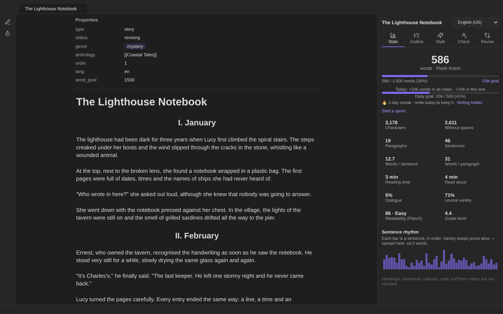
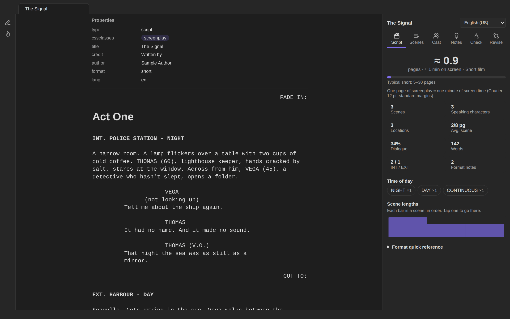
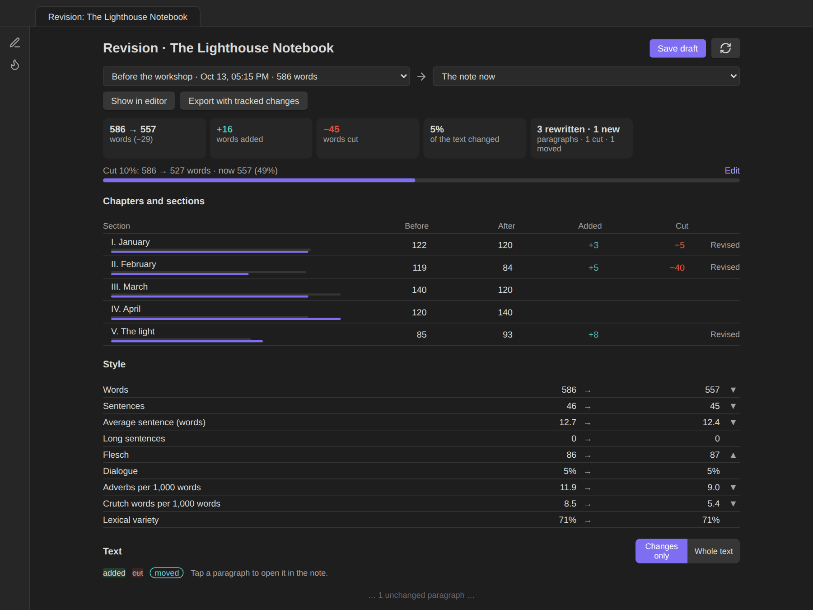
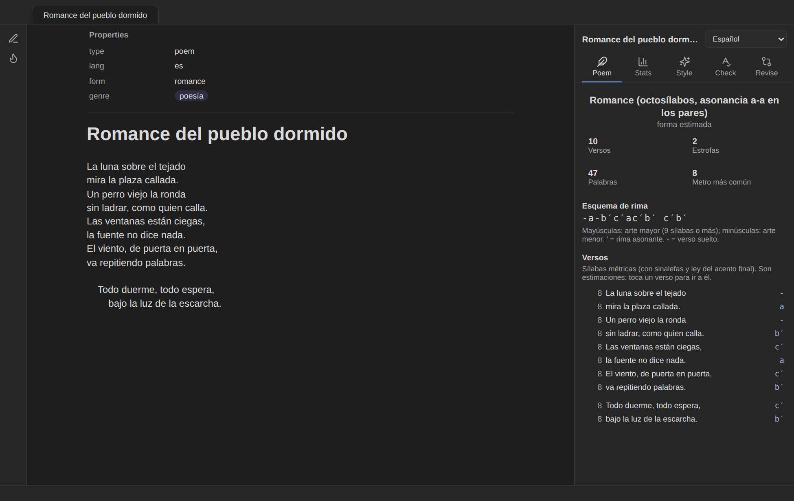
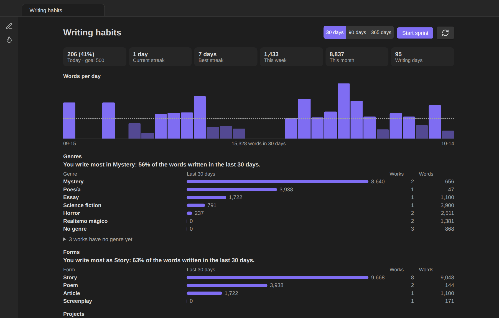
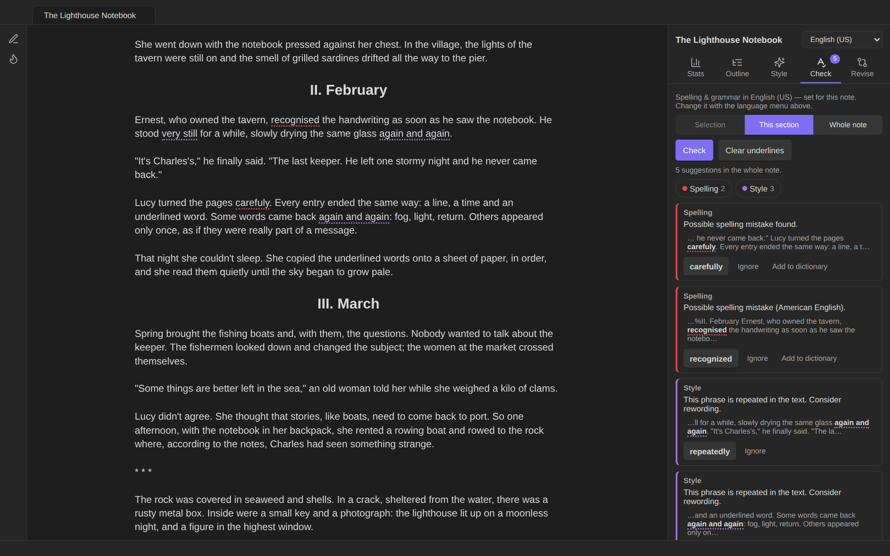

# Authors Toolbox

**Writing tools for fiction writers, poets and screenwriters in [Obsidian](https://obsidian.md).** A writing panel with statistics, a reorderable outline and style insights; an English and Spanish spelling and grammar check; screenplay and poetry modes; submission-ready Word, PDF and EPUB export; a writing-habits dashboard with goals, streaks, sprints and genres; and a revision mode that keeps drafts and shows what changed, down to the word.

It works on **macOS, Windows, Linux, iPhone and iPad** and requires Obsidian 1.7.2 or later. It uses no Node.js or Electron APIs, has no runtime dependencies, works offline except for the grammar check, and every control is touch-friendly.

📖 **[Read the wiki](https://github.com/danielroa98/Authors-Toolbox/wiki)** for a detailed guide to every feature, with screenshots, and an explanation of how it all works.



<table>
<tr>
<td width="33%"><br><sub><b>Screenplays</b> in Fountain, formatted as you type</sub></td>
<td width="33%"><br><sub><b>Manuscript export</b> with a live page preview</sub></td>
<td width="33%"><br><sub><b>Revision mode</b>: what changed since a draft</sub></td>
</tr>
<tr>
<td><br><sub><b>Poetry</b>: métrica, rhyme scheme and form</sub></td>
<td><br><sub><b>Writing habits</b>: goals, streaks and genres</sub></td>
<td><br><sub><b>Spelling and grammar</b> in English and Spanish</sub></td>
</tr>
</table>

---

## Contents

- [Features](#features)
  - [Writing panel](#writing-panel)
  - [Spelling and grammar](#spelling-and-grammar)
  - [Paragraph alignment](#paragraph-alignment)
  - [Images in the text](#images-in-the-text)
  - [Spanish dialogue dash (raya)](#spanish-dialogue-dash-raya)
  - [Screenplay mode](#screenplay-mode)
  - [Manuscript export (Word, PDF, EPUB, text)](#manuscript-export-word-pdf-epub-text)
  - [Copy for Substack](#copy-for-substack)
  - [Poetry mode](#poetry-mode)
  - [Writing habits](#writing-habits)
  - [Revision mode](#revision-mode)
- [Commands](#commands)
- [Note properties](#note-properties)
- [Settings](#settings)
- [Network use and privacy](#network-use-and-privacy)
- [Installation](#installation)
- [Roadmap: possible changes](#roadmap-possible-changes)
- [Known limitations](#known-limitations)
- [Development](#development)
- [License](#license)

---

## Features

### Writing panel

A sidebar for the note you're working on. Open it from the **pen icon** in the ribbon or with the command **Open writing panel**. It updates as you type. Poems and scripts get their own tabs (see below). [More in the wiki](https://github.com/danielroa98/Authors-Toolbox/wiki/Writing-panel).

| Tab | What it shows |
|---|---|
| **Stats** | Word count with a length label (flash fiction under 1,000 → short story → novelette from 7,500 → novella from 17,500 → novel from 40,000); characters with and without spaces; paragraphs and sentences; average sentence and paragraph length; reading and read-aloud time; share of dialogue; lexical variety (moving-average type/token ratio); readability (Flesch / Flesch–Kincaid for English, INFLESZ for Spanish); a **sentence-rhythm chart** (one bar per sentence); a per-note **word goal** with a progress bar; **words written today**; live counts for the **selected text**. |
| **Outline** | Chapters (headings) and scenes (separated by `---`, `* * *`, `⁂` or `#`) with word counts. Tap to jump. Drag the ⠿ handle, or use the ⋯ menu, to **reorder chapters and scenes**. Each move is a single undo step. |
| **Style** | Long sentences; **words repeated close together**; three or more sentences in a row that start with the same word; adverbs (‑ly / ‑mente); your **crutch words**; most-used words; **names and places**; longest paragraphs. Tap any item to highlight it in the text, and tap again to step to the next occurrence. |
| **Check** | Spelling and grammar suggestions (see below). |
| **Revise** | Changes since the last draft, the revision goal, drafts, and margin marks in the editor (see [Revision mode](#revision-mode)). |

Headings, comments, callouts, code blocks and front matter are not counted, so the numbers reflect your prose.

### Spelling and grammar

Obsidian has no grammar checker of its own, and its spellcheck follows the operating system. On macOS it often offers no suggestions when you write in more than one language. Authors Toolbox adds an on-demand check powered by [LanguageTool](https://languagetool.org):

- Check the **selection**, the **current section** or the **whole note**.
- Problems are underlined in the editor by type: spelling, grammar, punctuation and style.
- Tap an underline, or a card in the panel, to **apply a suggestion**, **ignore** it, **add the word to your personal dictionary** (character names, invented words) or **turn the rule off**.
- **Language per note:** use the menu at the top of the panel (Auto-detect, English US/UK, Español). It is saved as a `lang` property and also sets hyphenation for justified text.
- Long notes are split into parts automatically, within the free service's limits.

Nothing is sent until you press **Check**, and the first check asks for permission. See [Network use and privacy](#network-use-and-privacy).


→ More in the wiki: [Spelling and grammar](https://github.com/danielroa98/Authors-Toolbox/wiki/Spelling-and-grammar)
### Paragraph alignment

Center, right-align, left-align or justify **only the selected paragraphs**: right-click → *Center*, or use the commands. Each paragraph gets an invisible marker (`%%center%%`), so the alignment holds in Live Preview, Reading view and PDF export. Running the same command again toggles it off.


→ More in the wiki: [Paragraph alignment](https://github.com/danielroa98/Authors-Toolbox/wiki/Formatting-tools)
### Images in the text

**Insert image…** lets you browse your vault's folders for an image (it opens in your attachments folder) or upload one from your device. You can set its width, alignment and an optional italic caption.

### Spanish dialogue dash (raya)

In Markdown, a line that starts with `-` becomes a bullet list, which breaks Spanish-style dialogue. In story notes, Authors Toolbox handles this:

- A `-` typed at the **start of a line** becomes **—**, so `—¿Vienes? —preguntó.` stays dialogue.
- `--` anywhere becomes **—**.
- Hyphens inside words (*semi-dormida*) are left alone. Press undo right after if you really wanted a hyphen.
- **Convert dialogue dashes in this note** fixes text pasted from elsewhere.

Story notes are notes with `type: story`, or notes in the folders you list in the settings.

### Screenplay mode

Notes with `type: script` are written in **[Fountain](https://fountain.io)**, the plain-text screenplay format, and laid out as a screenplay. The layout uses Courier with standard indents and works in the editor, in Reading view and in PDF export.

- **Smart Enter:** after a character name, Enter starts the dialogue line. After dialogue or action, it leaves the blank line the next element needs. Shift+Enter always inserts a plain line break.
- **Suggestions:**
  - **Character names**, plus `(V.O.)`, `(O.S.)` and `(CONT'D)`.
  - **Locations** and **times of day** in scene headings (English and Spanish: `DAY`/`NIGHT`, `DÍA`/`NOCHE`…).
- **Format line as…:** scene heading, action, character, parenthetical, transition or centered text, from the right-click menu or as commands.
- **Writing panel tabs for scripts:**
  - **Script:** estimated pages and screen time, scenes, speaking characters, locations, dialogue share, INT/EXT and day/night breakdown, a scene-length chart, and a Fountain quick reference.
  - **Scenes:** a numbered scene board with lengths in eighths of a page. Drag to reorder scenes within an act; acts are `#` headings.
  - **Cast:** speeches, words spoken and scenes per character, plus every location.
  - **Notes:** coaching on screenwriting conventions:
    - dense action paragraphs and long speeches;
    - scene headings missing INT./EXT. or a time of day;
    - camera directions;
    - things the camera can't show ("thinks", "recuerda");
    - characters who speak before they're introduced in CAPS.
- **New script…** and **Adapt this story into a script**. The second creates a linked script and opens it next to the story.
- **Export as .fountain**, for Final Draft, Fade In, Highland, WriterSolo or Beat. The file is saved in an `Exports` folder next to the script.

The spelling and grammar check skips character names, scene headings and transitions in scripts.


→ More in the wiki: [Screenplay mode](https://github.com/danielroa98/Authors-Toolbox/wiki/Screenplays)
### Manuscript export (Word, PDF, EPUB, text)

Turn a story, a poem or a whole project into submission-ready files: run *Export manuscript as a document or PDF…*, or choose **Export manuscript…** in the note's ⋯ menu or the file explorer. The export window shows a **live preview of every page** while you change the options, and the PDF is printed from exactly that layout.

- **Formats:** Word (.docx), PDF, EPUB 3 (validated with EPUBCheck) and plain text (.txt, for submission forms that ask you to paste the story). Pick any combination.
- **Two layouts:**
  - **Standard manuscript:** your name and contact details top left, the rounded word count top right, the title and byline just below (a subtitle that already names you replaces the byline), and *Surname / Title / page* at the top of every following page.
  - **Contest (anonymous):** title and *Pseudonym: …* only, with page numbers at the bottom. A subtitle that names you (*Un relato de …*) is left out. Your name appears nowhere in the files, not even in their document properties. A note's `pseudonym` property overrides the default pseudonym.
- **Options:** Times New Roman, Courier or Arial at 12 pt; double or 1.5 spacing; Letter or A4; scene-break symbol (`#`, `* * *`, `—` or a blank line); a **cover page**; chapters on a new page; **keep justified paragraphs**.
- **Presets:** save the current options under a name (for example one per contest) and apply them in one tap. Presets never store your name or contact details.
- **Whole projects:** export an **anthology note** (the stories whose `anthology` property links to it, plus any it links to in its text, in that order) or **a folder** (right-click → *Export folder as one manuscript…*). Notes are ordered by an `order` property, then `date_created`, then name. Each note becomes a chapter that starts on a new page, with the total word count on the first page.
- **What goes in:** the first `#` heading is the title and a heading right under it the subtitle (or your byline, which is dropped). Every line is a paragraph with a first-line indent. Italics and bold are kept, headings become section titles, scene-break lines become the chosen symbol, and the text ends with *FIN* / *END*. Callouts (concept art, author notes), comments, images, tables and code are left out. Centered and right-aligned paragraphs keep their alignment. Poems keep their lines, indentation and stanzas.
- Files are saved in an `Exports` folder next to the note (or inside the exported folder). Everything is generated inside Obsidian, with no internet connection, on desktop, iPhone and iPad.


→ More in the wiki: [Manuscript export (Word, PDF, EPUB, text)](https://github.com/danielroa98/Authors-Toolbox/wiki/Manuscript-export)
### Copy for Substack

Post a story or poem on Substack without fixing it by hand after pasting: run *Copy for Substack…*, or choose **Copy for Substack…** in the note's ⋯ menu or the file explorer. A window shows the post as it will paste, with a **Copy** button for each part.

- **Title and subtitle** are copied on their own, because Substack keeps them in their own fields. The title is the first `#` heading (or the `title` property); the subtitle is a heading right under it, or the `subtitle` property.
- **The text** pastes as rich text: paragraphs, italics, bold, links, block quotes and section headings (your top-level sections become *Heading 2*, since Heading 1 is the post's title). Scene breaks become Substack **dividers**.
- **Poems keep their shape:** each stanza is one paragraph with a line break after each line (what Shift+Enter makes in Substack), so lines stay single-spaced and never run together. Indentation is kept with no-break spaces, which Substack doesn't remove.
- The window lists what Substack can't receive, so you can add it there: images, footnotes, and centred or right-aligned text (Substack has no text alignment). Callouts, comments, tables and code are left out, and your byline is dropped (Substack shows it on every post).
- Apps that only take plain text receive a plain version with the same lines and paragraphs.

→ More in the wiki: [Copy for Substack](https://github.com/danielroa98/Authors-Toolbox/wiki/Substack)
### Poetry mode

Mark a note with `type: poem` (or `poema`, `poesía`), or add `poem` to its `cssclasses`, and it is treated as verse:

- **Layout:** every line stays a line and keeps its indentation, in the editor and in Reading view (indented lines are no longer turned into code blocks, and lines aren't merged even with "strict line breaks" on). Long lines wrap with a **hanging indent**, a blank line separates stanzas, and `%%center%%` / `%%right%%` still align a stanza.
- **Poem tab** in the writing panel:
  - **Syllables per line.** Spanish uses *métrica*: syllables with *sinalefa* between words, *hiato* on accented weak vowels and the *ley del acento final* (aguda +1, esdrújula −1). Hover a line to see how the count was reached. English counts are approximate.
  - **Rhyme scheme** by stanza (ABBA ABBA CDC DCD). In Spanish, consonant rhyme gets a letter and assonant rhyme a letter with ′; uppercase for *arte mayor*, lowercase for *arte menor*.
  - **Form:** sonnet, haiku (5‑7‑5), *décima espinela*, *romance*, couplets to octaves, isometric verse or free verse.
  - Tap a line to jump to it.
- **Export:** single-spaced lines with their indentation, a blank line between stanzas, never justified.


→ More in the wiki: [Poetry mode](https://github.com/danielroa98/Authors-Toolbox/wiki/Poetry)
### Writing habits

Open **Writing habits** (ribbon flame icon or command) for a dashboard of how and what you write:

- **Words per day** for the last 30, 90 or 365 days (weekly bars for the year), with your **daily goal** as a line. "Words written" counts what each note grew by in a day, so editing and cutting don't erase a day's work. About 13 months of history are kept, and renamed notes keep theirs.
- **Today, this week, this month**, writing days, and your **current and best streak** (days that reach the daily goal, or any writing when there's no goal). The Stats tab shows today's goal progress and the streak too.
- **Writing sprints:** *Start a writing sprint…* sets a timer and a word target. A countdown and the words written appear in the status bar and the writing panel; at the end a summary shows words, words per minute and whether you hit the target. Words in any note count.
- **Genres:** give each work a `genre` property (one or several: `genre: [terror, cuento urbano]`), or use *Set genre of this note…*, which suggests the genres you already use. The dashboard shows **which genre you write most** in the period, words written per genre, and how many works and words you have in each. Works without a genre are listed so you can tag them in place.
- **Forms and projects:** the same breakdown by form (story, poem, screenplay, article…, from `type`) and per project (from `anthology`), with progress towards a project's `word_goal`.
- The breakdowns read the notes in your **writing folders** (a setting; by default the story folders and the scripts folder).


→ More in the wiki: [Writing habits](https://github.com/danielroa98/Authors-Toolbox/wiki/Writing-habits)
### Revision mode

Revising is not drafting: the word count may go down, and what matters is *what changed*. Revision mode keeps drafts of a note and shows the changes between any two versions.

- **Drafts:** *Save a draft of this note…* (command, the **Revise** tab or the note's ⋯ menu) keeps a named copy, with an optional note ("sent to the workshop"). A draft is also kept **automatically** the first time you open a writing note each day, if it changed since the last one, so you can always see what you changed today. Automatic drafts are kept for 30 days (a setting); named ones until you delete them.
- **Compare** (*Compare drafts of this note*) opens the revision page. Pick two versions (a draft and the note now, or two drafts) and see:
  - **Summary:** words before and after, words added and cut, how much of the text changed, and how many paragraphs were rewritten, added, cut or moved.
  - **Chapters and sections:** words before and after for each heading, with what was added and cut, and whether the section is new, cut, revised, renamed or moved.
  - **Style:** sentences, average sentence length, long sentences, readability, dialogue, adverbs and crutch words per 1,000 words, and vocabulary variety, before → after.
  - **The text** with additions, cuts and moved paragraphs marked word by word. *Changes only* hides untouched paragraphs. Tap a paragraph to open it in the note; **Restore** puts a cut paragraph back, **Undo changes** brings back a paragraph's earlier wording.
  - **Drafts:** the history of the note with words and change from the previous draft. Compare, rename, restore a whole draft (the current text is saved first and the note keeps its properties), copy it to a new note, or delete it.
- **Revision goal:** *cut 10%* or *reach 5,000 words*, measured from a draft, with a progress bar on the revision page and in the Revise tab.
- **Changes in the editor:** *Show changes in the editor* marks new lines (green), rewritten lines (orange) and where text was cut (red) in the margin, updated as you type.
- **Tracked changes for your editor:** *Export with tracked changes* writes a manuscript (.docx) in which the changes since a draft are real tracked changes that can be accepted or rejected in Word, Pages, Google Docs or LibreOffice.
- Drafts are stored as one small file per note in `.authors-toolbox/drafts` in your vault (a setting). The dot keeps them out of search, the graph, Dataview and word counts; they sync with your vault and stay if you uninstall the plugin.


→ More in the wiki: [Revision mode](https://github.com/danielroa98/Authors-Toolbox/wiki/Revision-mode)
---

## Commands

| Command | |
|---|---|
| Open writing panel | |
| Center / Align right / Align left / Justify selected text, Clear alignment | also in the right-click menu |
| Insert image… | also in the right-click menu |
| Check spelling & grammar: selection / current section / whole note | |
| Clear spelling & grammar underlines | |
| Set note language: Español / English / auto-detect | |
| Convert dialogue dashes (- → —) in this note | |
| Export manuscript as a document or PDF… | also in the note's ⋯ menu and the file explorer; anthology notes export as a project |
| Export folder as one manuscript… | right-click a folder in the file explorer |
| Copy for Substack… | also in the note's ⋯ menu and the file explorer |
| Open writing habits / Start a writing sprint… / Stop the writing sprint | |
| Set genre of this note… | |
| Save a draft of this note… / Compare drafts of this note | also in the note's ⋯ menu |
| Show or hide changes since the last draft in the editor | |
| Export the changes since the last draft with tracked changes (.docx) | |
| Set a revision goal for this note… | |
| Screenplay: new script… / adapt this story into a script / export as .fountain | |
| Screenplay: format line as Scene heading / Action / Character / Parenthetical / Transition / Centered | also in the right-click menu in scripts |
| Screenplay: insert page break | |
| Screenplay: turn script formatting on/off for this note | |

On iPhone and iPad, add the commands you use most to the mobile toolbar (**Settings → Mobile**).

## Note properties

| Property | Used for |
|---|---|
| `type: story` | Marks a story: turns on the dialogue dash. |
| `type: script` (+ `cssclasses: [screenplay]`) | Turns on screenplay mode. |
| `lang: es` / `en-US` / `en-GB` | Language for statistics, readability, crutch words and the grammar check. |
| `word_goal: 3000` | Word goal shown in the Stats tab. |
| `format: short` / `feature` / `pilot` | Script length target shown in the Script tab. |
| `title`, `credit`, `author`, `adapted_from`, `draft_date`, `contact` | Title page of the `.fountain` export. |
| `title`, `pseudonym` | Title and pen name of an exported manuscript. |
| `title`, `subtitle` | Title and subtitle of a Substack post. |
| `order` | Position of a chapter or story in a project export. |
| `genre` (or `genres`, `género`) | Genres of a work, for the writing-habits breakdown. |
| `word_goal` on a project note | Word goal of an anthology or collection. |
| `type: poem` (or `cssclasses: [poem]`) | Turns on poetry mode. |

## Settings

- **Images:**
  - Upload folder (defaults to Obsidian's attachment location).
  - Default width and alignment.
- **Writing panel:**
  - Default language and default word goal.
  - Reading and read-aloud speeds.
  - Long-sentence threshold and repetition window.
  - Crutch-word lists for English and Spanish.
  - Count each line as a paragraph.
- **Stories:**
  - Turn the dialogue dash on or off.
  - Story folders.
- **Writing habits:**
  - Daily word goal and writing folders.
  - Default sprint length and word target.
- **Revision:**
  - Keep a daily draft automatically, and for how many days.
  - Drafts folder.
- **Manuscript export:**
  - Default layout.
  - Font, line spacing and page size.
  - Contact details and pseudonym.
  - Chapters on a new page, keep justified paragraphs, scene-break symbol and cover page.
- **Screenplays:**
  - Scripts folder and author name.
  - Smart Enter.
- **Spelling and grammar:**
  - Permission to use LanguageTool.
  - Server URL.
  - Optional LanguageTool Premium username and API key.
  - Picky mode.
  - Personal dictionary.
  - Turned-off rules.

## Network use and privacy

Authors Toolbox uses the network **only for the spelling and grammar check, and only when you ask for it.**

- **What is sent:** when you press **Check** (or run a *Check spelling & grammar* command), the text in the scope you chose (selection, current section or whole note) is sent to **LanguageTool**, by default `https://api.languagetool.org`.
- **When:** never automatically. The first check asks for your permission, which you can withdraw in the settings.
- **Why:** to get English and Spanish spelling and grammar suggestions that work the same on every device.
- **Which server:** you can use your own [LanguageTool server](https://dev.languagetool.org/http-server) instead. LanguageTool's handling of text is described in its [privacy policy](https://languagetool.org/legal/privacy).

The free LanguageTool service is limited to about 20 KB per request and 75 KB per minute. Authors Toolbox splits long notes and waits between parts when needed. **LanguageTool Premium** (a paid LanguageTool service) is optional.

Everything else runs entirely on your device: statistics, style insights, outline, alignment and screenplay layout. The plugin stores its settings and a small daily word count in its own `data.json` inside your vault, and drafts in `.authors-toolbox/drafts`. It includes no telemetry and no ads.

## Installation

**From Obsidian:** Settings → Community plugins → Browse → search **Authors Toolbox** → Install → Enable.

**Manually:**
1. Download `main.js`, `manifest.json` and `styles.css` from the [latest release](../../releases/latest).
2. Copy them to `<your vault>/.obsidian/plugins/authors-toolbox/`.
3. Reload Obsidian and enable **Authors Toolbox** under Settings → Community plugins.

**Beta versions:** install from this repository with the [BRAT](https://obsidian.md/plugins?id=obsidian42-brat) plugin.

---

## Roadmap: possible changes

Ideas under consideration, roughly in order of priority. Nothing here is promised; suggestions are welcome in the issues.

Recently done: the TypeScript rewrite and searchable settings (1.5.1), dialogue detection on every line (1.5.2), manuscript export with a live preview (1.6), EPUB, plain text, project export, presets and the first part of poetry mode (1.7), writing habits with sprints, streaks and genre tracking (1.8), revision mode with drafts, comparisons and tracked changes (1.9), and Copy for Substack (1.10).

### Writing habits: next steps
- **Words revised per day** in the habits dashboard, so revision days count too; recovering a deleted note from its drafts.
- **Calendar heatmap** of writing days, weekly or monthly goals, and a goal per genre.

### Writing and manuscripts
- **Table of contents** in Word and PDF project exports, and an EPUB cover image.

### Poetry mode: next steps

The first part of poetry mode is in (layout, syllables, rhyme scheme, form, export). Next:

- **English meter:** stress patterns with a pronunciation dictionary (iambic pentameter and others).
- **Optional line numbers** every 5 lines, and styles for epigraphs and dedications.
- **Targets and warnings:** flag lines that break the poem's meter (for example a line of 10 in a sonnet of hendecasyllables).
- **Sound and repetition:** alliteration and repeated words in the Poem tab; villanelle and other refrain forms.
- **Collections:** poetry books through project export, one poem per page.

### Screenplays
- **Exact pagination** and a screenplay-ready **PDF export** (Courier 12 pt, standard margins, title page, `(MORE)`/`(CONT'D)` across pages, scene numbers), reusing the PDF engine and live preview of the manuscript export.
- **Final Draft (`.fdx`) export**, generated from the same element detection as the screenplay layout.
- **Dual dialogue** shown side by side.
- **Title page** rendering inside Obsidian.
- **Production helpers:** scene numbering locks, revision colours, a character and location report.
- A **Fountain import** command for existing `.fountain` files.

### Language and checking
- **More languages** for statistics and checks (Portuguese and French first).
- **Spanish-language interface.**
- **Automatic checking** of the current paragraph after a pause, with the same consent and limits.

### Small improvements
- Dialogue-dash conversion for pasted text without running a command.
- Keyboard shortcuts for moving sections up and down in the outline.

## Known limitations

- The grammar check needs an internet connection, unless you run your own LanguageTool server.
- Page counts for scripts are estimates (55 lines per page with standard element widths), not exact pagination.
- Statistics and style insights support English and Spanish; other languages fall back to English rules.
- Obsidian's own spellcheck still runs alongside. On iPhone and iPad it follows the keyboard language.
- Syllable counts and rhyme are estimates: poets bend the rules (*sinéresis*, *diéresis*, licences), and English has no stress analysis yet.
- Drafts are kept in a hidden folder of the vault (`.authors-toolbox/drafts`). iCloud, Dropbox and Git sync it; Obsidian Sync may skip hidden folders, in which case choose a visible drafts folder in the settings.
- Exported PDFs use the PDF standard fonts (Times, Helvetica for Arial, Courier), which cover Spanish and Western European characters; other scripts print as "?". Word files use the real fonts.

---

## Development

```bash
npm install
npm run dev     # rebuild main.js on every change (copy or symlink the folder into a test vault)
npm run lint    # Obsidian's official ESLint rules (the same checks as the directory's automated review)
npm run typecheck  # TypeScript strict-mode check
npm run build   # type-check + production build → main.js
npm test        # behaviour tests (Node's test runner; Obsidian is mocked, CodeMirror and the DOM are real)
```

The tests live in `tests/`: each `*.test.cjs` file loads the plugin into a small stand-in for Obsidian
(`tests/support/obsidian-mock.cjs`) and drives it like a writer would: typing, moving sections, running the
grammar check against a fake LanguageTool, exporting, writing sprints. The sample notes in `tests/fixtures/`
were written for the tests. `npm test -- export` runs only the files whose name contains `export`.
Every push and pull request runs type checking, lint and the tests (`.github/workflows/ci.yml`), and a release
is only built when they pass.

Source layout (TypeScript in strict mode, bundled by esbuild into `main.js`):

```
src/
├── main.ts                  # plugin entry: commands, events, panel state, grammar check, screenplay commands
├── constants.ts             # defaults and shared constants
├── settings.ts              # settings tab
├── text/analysis.ts         # pure text analysis: prose map, stats, readability, style, outline, LanguageTool chunks
├── screenplay/
│   ├── fountain.ts          # Fountain parser, script analysis, scene outline, .fountain export
│   ├── editor.ts            # editor formatting, smart Enter, suggestions, Reading view, script template
│   └── panel.ts             # writing-panel tabs for scripts
├── editor/
│   ├── alignment.ts         # per-paragraph alignment markers and decorations
│   ├── issues.ts            # grammar underlines and find highlights (CodeMirror state)
│   └── raya.ts              # Spanish dialogue dash
├── view/
│   ├── writing-view.ts      # the writing panel
│   └── helpers.ts           # formatting helpers and labels
├── export/
│   ├── manuscript.ts        # story note → manuscript (title, headings, paragraphs, emphasis, scene breaks)
│   ├── layout.ts            # page layout with font metrics, shared by the PDF and the preview
│   ├── pdf.ts               # PDF writer (standard fonts, no dependencies)
│   ├── docx.ts              # Word writer (Office Open XML)
│   ├── epub.ts              # EPUB 3 writer
│   ├── text.ts              # plain-text writer
│   ├── substack.ts          # Substack post: title, subtitle, HTML and plain text to paste
│   ├── zip.ts               # minimal ZIP writer for .docx
│   └── widths.ts            # glyph widths of the PDF standard fonts
├── poetry/
│   ├── poem.ts              # poem-note detection
│   ├── metrics.ts           # syllables (Spanish métrica, English), rhyme scheme, form
│   ├── editor.ts            # verse layout in the editor and Reading view
│   └── panel.ts             # Poem tab of the writing panel
├── habits/
│   ├── log.ts               # daily history: words written, streaks, totals, per-group sums
│   ├── genres.ts            # genre, form and project of a work from its properties
│   ├── sprint.ts            # sprint timing, start and summary windows
│   ├── genre-modal.ts       # genre picker
│   └── view.ts              # writing-habits dashboard
├── revision/
│   ├── diff.ts              # comparing two versions: paragraphs, words, moves, sections, editor marks
│   ├── store.ts             # drafts, one JSON file per note in the drafts folder
│   ├── controller.ts        # saving, restoring, checkpoints, editor marks, tracked-changes export
│   ├── tracked.ts           # manuscript with tracked changes (for the Word writer)
│   ├── view.ts              # revision page
│   ├── panel.ts             # Revise tab of the writing panel
│   ├── editor.ts            # change marks in the editor margin
│   └── modals.ts            # draft, goal and confirmation windows
└── modals/
    ├── export-manuscript.ts # export window with live page preview
    ├── substack.ts          # Copy for Substack window and rich-text clipboard
    ├── insert-image.ts
    └── prompts.ts
tests/
├── *.test.cjs               # one file per area: plugin, screenplay, poetry, export, substack, habits, revision, analysis
├── fixtures/                # sample notes
└── support/                 # Obsidian mock, test helpers, bundle entry
```

### Wiki

The wiki's pages and images live in [`docs/wiki/`](docs/wiki) and are published to the GitHub wiki with `scripts/publish-wiki.sh`. The screenshots are rendered from the plugin's own code with the sample notes, never from a real vault.

### Releasing

1. Update `version` in `manifest.json` and `package.json`, and add the version to `versions.json`.
2. Commit, then tag with the same version and push the tag:
   ```bash
   git tag -a 1.10.0 -m "1.10.0"
   git push origin 1.10.0
   ```
3. The GitHub Action checks that the tag matches `manifest.json`, runs lint and the tests, builds the plugin and creates a **draft release** with `main.js`, `manifest.json` and `styles.css` and a build-provenance attestation. Review it and publish.

See [CHANGELOG.md](CHANGELOG.md) for the version history.

## License

[MIT](LICENSE) © 2026 Daniel Roa
