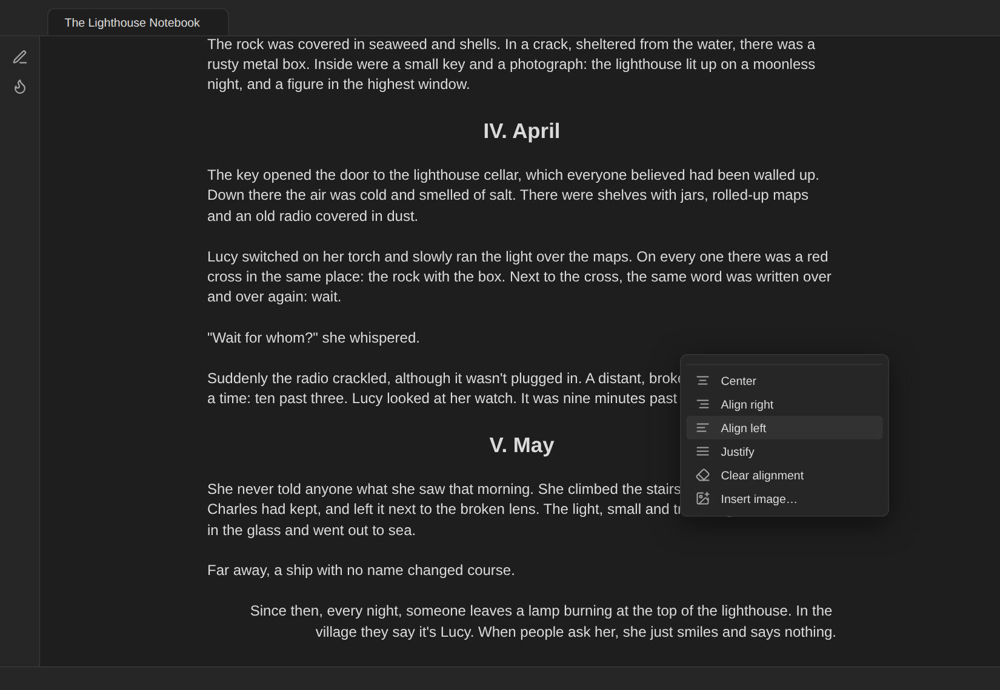
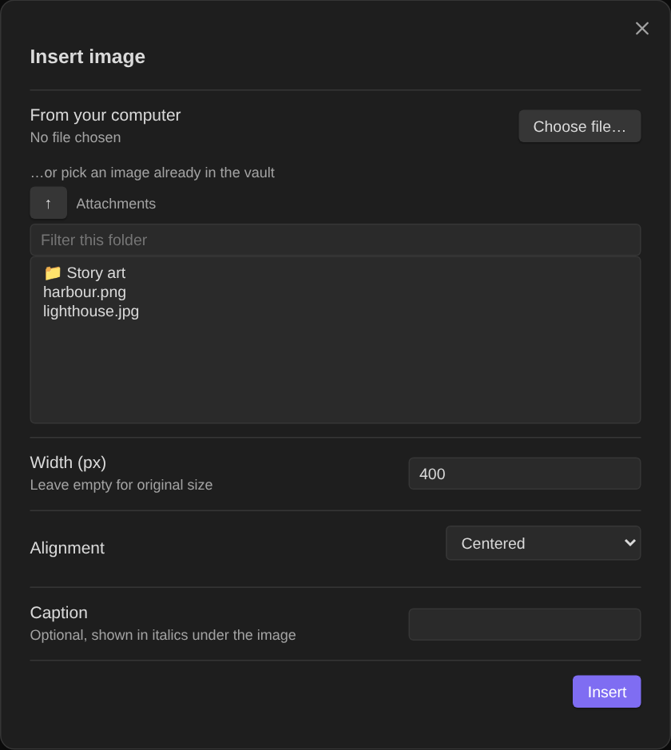
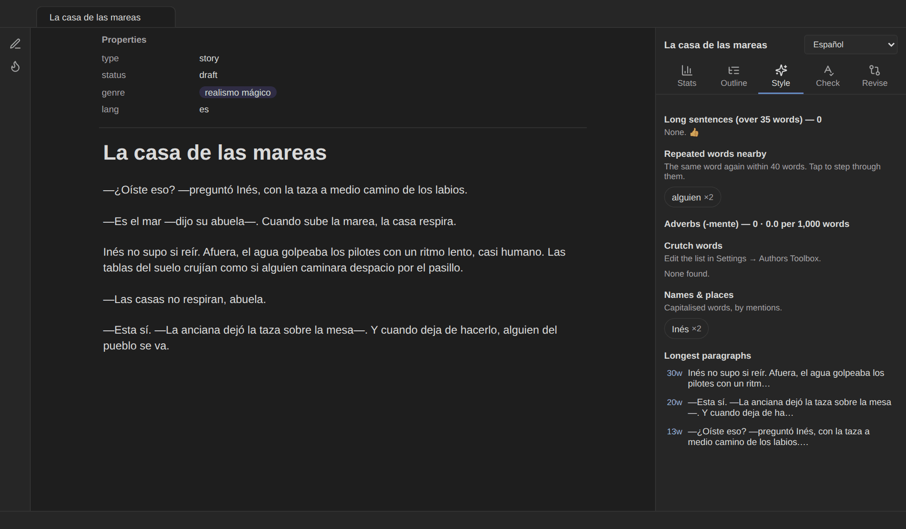

# Formatting tools

Three small tools for the way fiction is laid out on the page.

## Paragraph alignment

Markdown has no way to centre or right-align a single paragraph. Authors Toolbox adds one.

- Put the cursor in a paragraph (or select several) and choose **Center**, **Align right**, **Align left** or **Justify** from the right-click menu or the commands (*Center selected text*, …). **Clear alignment** removes it; choosing the same alignment again also toggles it off.
- The plugin writes an invisible marker at the start of the paragraph, for example `%%center%%`. It is an Obsidian comment, so the text stays plain Markdown and other apps simply ignore it.
- The alignment shows in **Live Preview** (the marker hides unless the cursor is on that line), in **Reading view**, in Obsidian's PDF export and in the plugin's own [manuscript export](Manuscript-export).
- It works on headings too (`## %%center%%Chapter one`), which is how the chapter titles in the screenshots are centred.
- Lists, tables, quotes, code blocks and embeds are skipped.

**Justified text** uses the note's language for hyphenation, so long Spanish words break correctly.

## Images in the text

**Insert image…** (command or right-click menu) opens a picker:

- **From your computer:** choose a file; it's copied into the image folder from the settings, or Obsidian's attachment folder.
- **…or pick an image already in the vault:** browse folder by folder, starting in your attachments folder, with a filter box. Only images are listed, and the vault is never scanned as a whole, so it stays fast in large vaults.
- **Width** in pixels (empty for the original size), **alignment** (inline, centred, left, right) and an optional **caption**, written in italics under the image with the same alignment.

The result is ordinary Markdown: `![[lighthouse.jpg|400]]` plus an alignment marker and the caption line.

## Spanish dialogue dash (raya)

In Spanish, dialogue starts with a raya: `—¿Vienes? —preguntó.` In Markdown, a line that starts with `-` becomes a bullet list, so dialogue typed with a hyphen breaks. In story notes, Authors Toolbox fixes this as you type:

- A `-` typed at the **start of a line** becomes **—**.
- `--` anywhere becomes **—**, for the dashes around a speaker tag: `—Vuelve --dijo él-- por favor.` → `—Vuelve —dijo él— por favor.`
- Hyphens inside words (*semi-dormida*) are left alone, and task lists (`- [ ]`) are never touched.
- **Undo** right after the change gives you back the plain hyphen.
- **Convert dialogue dashes (- → —) in this note** fixes dialogue pasted from elsewhere: every line that starts with a hyphen followed by text gets a raya.

It applies to **story notes**: notes with `type: story`, or notes in the story folders from the settings. It never applies to scripts or other notes, so ordinary lists keep working. Turn it off with *Dialogue dash (raya)* in the settings.

The statistics recognise raya dialogue: the narrator's tags between dashes (*—dijo ella—*) are counted as narration, not dialogue.
