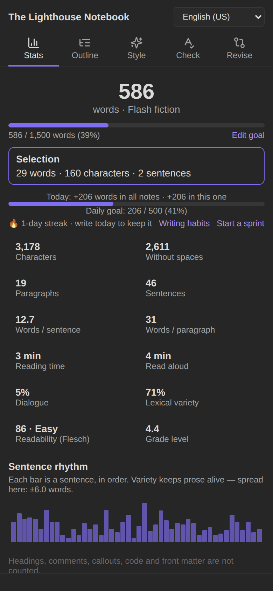

# Getting started

## Install

**From Obsidian:** Settings → Community plugins → Browse → search **Authors Toolbox** → Install → Enable.

**Manually:**

1. Download `main.js`, `manifest.json` and `styles.css` from the [latest release](https://github.com/danielroa98/Authors-Toolbox/releases/latest).
2. Copy them into `<your vault>/.obsidian/plugins/authors-toolbox/` (create the folder if needed).
3. Reload Obsidian and enable **Authors Toolbox** under Settings → Community plugins.

**Beta versions:** add `danielroa98/Authors-Toolbox` to the [BRAT](https://obsidian.md/plugins?id=obsidian42-brat) plugin.

After enabling, two icons appear in the ribbon: the **pen** opens the [writing panel](Writing-panel) and the **flame** opens [writing habits](Writing-habits). The writing panel also opens on its own the first time.

## Set up your vault

Authors Toolbox works with any folder structure. Three settings tell it where your writing lives:

| Setting | What it's for | Example |
|---|---|---|
| **Story folders** (Stories) | Notes here are treated as stories (dialogue dash on). | `Writing/Stories` |
| **Scripts folder** (Screenplays) | Where new scripts and adaptations are created. | `Writing/Scripts` |
| **Writing folders** (Writing habits) | Notes counted in the genre, form and project breakdowns, and kept as daily drafts. | `Writing` |

You don't need any of them to start: a `type` property on a note does the same job (see [Note properties](Note-properties)).

## Your first story

1. Create a note and add these properties (or put the note in a story folder):

   ```yaml
   ---
   type: story
   lang: en          # or es; leave it out to auto-detect
   genre: [mystery]
   word_goal: 3000
   ---
   ```

2. Write a title as the first `#` heading, then the text. Use `##` headings for chapters and a line with `* * *`, `---` or `#` for scene breaks.
3. Open the writing panel (pen icon). The **Stats** tab shows your word count, goal and readability; **Outline** lists chapters and scenes; **Style** points out repetitions and crutch words.
4. When you're ready to revise, **Save a draft** in the **Revise** tab, so you can compare later.
5. To submit, use **Export manuscript…** in the note's ⋯ menu.

## On iPhone and iPad



Every feature works on mobile. Open the writing panel from the ribbon (swipe from the right edge), and add the commands you use most (for example *Save a draft of this note…* or *Start a writing sprint…*) to the mobile toolbar in **Settings → Mobile**.

<br clear="right">

## Templates

If you use the Templater or core Templates plugin, a story template only needs the properties above. For poems use `type: poem`; for screenplays, run **Screenplay: new script…**, which creates a script from a built-in template (English or Spanish).
