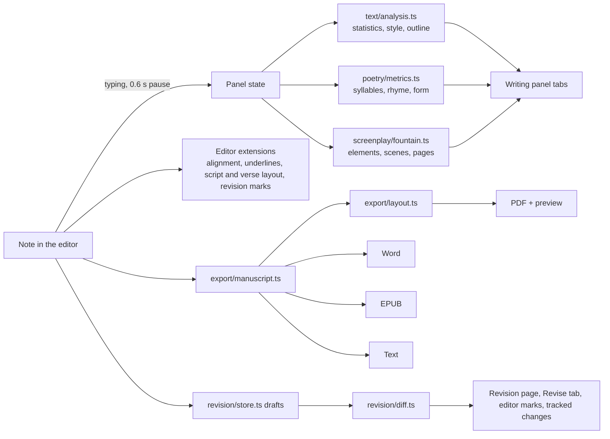

# How it works

This page explains what happens behind each feature: how the plugin is built, and the methods behind the numbers. It's for the curious writer as much as for developers.

## Architecture

Authors Toolbox is written in TypeScript and bundled into a single `main.js`. It has **no runtime dependencies**: the text analysis, metrics, page layout, PDF, Word, EPUB and ZIP writers and the comparison engine are all part of the plugin. It uses only Obsidian's public API and CodeMirror 6 (the editor Obsidian is built on), so it runs the same on desktop and mobile.



The analysis modules are **pure functions** (text in, numbers out, no Obsidian APIs), which is what lets the test suite check them in Node against sample notes.

**When things update:** the panel recomputes a moment after you stop typing (0.6 s on desktop, 1.2 s on mobile), only for the active note, and only if the panel is open. With the panel closed, the plugin only keeps today's word count. Editor features (alignment, underlines, script and verse layout, revision marks) are CodeMirror decorations, updated as the document changes without touching the note's text.

## Reading the note: the prose map

Before counting anything, a note is turned into a **prose map**: a list of paragraphs with their plain text (Markdown syntax, comments, links' targets, embeds removed) and a map from every character of the plain text back to its position in the note. Front matter, code blocks, callouts, tables and comments are skipped.

The map is why tapping a style item can highlight the exact words in the editor, and why grammar suggestions land on the right characters even when the text around them has `**bold**`, `[[links]]` or `%%comments%%`.

## Statistics

| Number | How it's computed |
|---|---|
| **Words** | Runs of letters and digits, with inner apostrophes and hyphens (*l'été*, *semi-dormida* are one word). |
| **Sentences** | Split after `.`, `!`, `?`, `…` (and closing quotes), except after abbreviations (*Mr.*, *Sra.*, *etc.*), single initials, or when the next word starts in lowercase (*"Really?" she asked*, *—¿Vienes? —preguntó*). |
| **Syllables** | English: vowel groups, minus a silent final *e* and *-ed*/*-es* endings, at least one per word. Spanish: vowel nuclei with diphthongs (a weak vowel next to another vowel) and hiatos (two strong vowels, or an accented weak vowel). |
| **Flesch Reading Ease** (English) | 206.835 − 1.015 × (words / sentences) − 84.6 × (syllables / words). 90–100 very easy, 60–70 standard, below 30 very difficult. |
| **Flesch–Kincaid grade** (English) | 0.39 × (words / sentences) + 11.8 × (syllables / words) − 15.59. |
| **INFLESZ** (Spanish) | Szigriszt-Pazos: 206.835 − 62.3 × (syllables / words) − (words / sentences), read on the INFLESZ scale: under 40 very difficult, 55–65 normal, over 80 very easy. |
| **Lexical variety** | Moving-average type/token ratio (MATTR): the share of different words in every window of 100 words, averaged. Unlike a plain type/token ratio, it doesn't fall just because a text is long. |
| **Dialogue** | Words inside dialogue spans divided by all words (see [how dialogue is detected](Writing-panel#how-dialogue-is-detected)). |
| **Reading time** | Words ÷ reading speed (230 wpm by default); read-aloud time with 150 wpm. |
| **Language** | Auto-detect counts common English and Spanish words in the first 20,000 characters, and gives extra weight to ñ, accented vowels and ¿ ¡. |

**Style insights** use a list of common words per language (articles, pronouns, auxiliaries…) that are never reported. *Names and places* are words capitalised in at least 80% of their mid-sentence appearances. *Repeated words nearby* tracks the last position of each content word and reports a word seen again within the window (40 words).

## Spelling and grammar

The text in scope is sent to LanguageTool as **annotated text**: a list of pieces that are either *text* (to check) or *markup* (to skip, sometimes with a hint, such as a paragraph break). LanguageTool returns problems with offsets into the combined text, and the prose map converts them back to positions in the note, so each underline covers exactly the flagged characters.

Long notes are split into chunks at paragraph boundaries under the service's size limit (about 18 KB, or 60 KB with a premium account). The plugin remembers the bytes sent in the last minute and waits when the next chunk would exceed the free tier's 75 KB per minute. Underlines are a CodeMirror state field: they move with the text as you type, and an underline disappears when you edit inside it.

## Screenplays

Each line of a script is classified as a Fountain element from its shape and context: scene headings by prefix (`INT.`, `EXT.`…) or a leading `.`; a character is a line in capitals followed by text (or `@`-forced); parentheticals and dialogue follow a character; transitions end in `TO:` or match a list of English and Spanish transitions; `> … <` is centered. The editor adds a CSS class per element, which the plugin's stylesheet turns into screenplay layout; Reading view gets the same through a post-processor.

**Page count:** every element is wrapped at its standard width in characters (action 61, dialogue 35, parenthetical 26, character 38…), blank lines included, and divided by 55 lines per page, the way screenwriting software counts. A scene's length is shown in eighths of a page, the production convention.

## Poetry

See [Poetry → How syllables are counted](Poetry#how-syllables-are-counted) for the Spanish *métrica* rules. The **form** is recognised from the number of lines and stanzas, the syllable counts (allowing ±1 for the poet's licences) and the rhyme scheme: 14 hendecasyllables → sonnet; 5‑7‑5 → haiku; 10 octosyllables in abbaaccddc → décima; octosyllables with one assonance on the even lines and none on the odd ones → romance; otherwise stanza patterns or free verse.

## Manuscript export

1. **Manuscript model** (`export/manuscript.ts`): the note becomes a title, a subtitle and a list of blocks (paragraphs with bold/italic runs, headings, scene breaks, verse lines, stanza gaps). Every writer starts from this model, so the rules about what goes in are the same in every format.
2. **Page layout** (`export/layout.ts`): lines are broken word by word using the real **glyph widths** of the PDF standard fonts (Times, Helvetica, Courier, with their bold and italic variants), then placed on pages with 1-inch margins. Justified lines get extra word spacing; headings are kept on the same page as the line after them; page headers and footers are added per layout. The **live preview** draws this same layout, which is why it matches the PDF exactly.
3. **Writers:**
   - **PDF** (`export/pdf.ts`): written by hand: page objects, content streams placing each text segment, font resources, the cross-reference table and document info (no author in contest mode). Text is encoded in WinAnsi, the standard fonts' character set.
   - **Word** (`export/docx.ts`): Office Open XML (document, styles, settings, header or footer with a PAGE field, core properties) in a ZIP written by `export/zip.ts` (stored entries, CRC-32).
   - **EPUB 3** (`export/epub.ts`): `mimetype` stored first and uncompressed, container, package document, navigation document, NCX for older readers, one XHTML file per chapter and a stylesheet. Validated with EPUBCheck.
   - **Text** (`export/text.ts`).

## Writing habits

The daily log is a small table: `day → note path → {first count of the day, latest count}`. Words written on a day are the sum over notes of `max(0, latest − first)`. Days older than 400 are pruned; renaming a note renames its entries. Streaks walk back from yesterday (or today, if today already reached the goal) while each day reaches the goal. Genres, forms and projects come from each note's properties through Obsidian's metadata cache, and words per genre combine the daily log with each note's genres.

## Comparing versions

The engine in `revision/diff.ts` compares two versions of a note in four steps.

1. **Align paragraphs.** Each non-empty line of the body is a paragraph. The two lists are compared with the **Myers diff algorithm** (the one behind `git diff`), which finds the shortest list of paragraphs to remove and add to turn one version into the other. Common paragraphs at the start and end are trimmed first, and the search is bounded (1,500 differences), so comparing two drafts of a novel stays fast; beyond the bound, the middle is treated as replaced.
2. **Pair rewrites.** Within each block of removed and added paragraphs, a removed paragraph is paired with the most similar added paragraph ahead of it (within 40 paragraphs, keeping the order) if they share at least 45% of their words (Dice coefficient). A paired couple is a **rewritten** paragraph; the others are **cut** or **new**. A heading replaced by one other heading of the same level is a **renamed** section.
3. **Compare words.** Each rewritten paragraph is split into words, spaces and punctuation and compared with the same Myers algorithm. A lone space or punctuation mark kept between two changes is folded into the change, and each change is shown as one cut followed by one addition, so it reads *~~creaked~~ groaned* rather than a scatter of fragments.
4. **Find moves.** A cut paragraph and a new paragraph with exactly the same text are a **move**.

**Sections** are matched by heading text (and renamed headings by step 2). Each change is credited to its section; moved paragraphs change both sections' counts but not the words added or cut. A section that changed place relative to the others (it's not in the longest run of sections that kept their order) is **moved**.

**Text changed** = (words added + words cut) ÷ (words before + words after).

**Editor marks** run the paragraph alignment on lines as you type: lines added inside a block that also removed lines are *rewritten*, others *new*, and a block that only removed lines marks the line after it as *cut above*.

**Tracked changes** compare the two versions' manuscript models block by block (so the Word file has the same layout as a normal export), then word by word, keeping bold and italics. Added text becomes `<w:ins>`, cut text `<w:del>`, and whole added or cut paragraphs also mark their paragraph mark, so accepting a deletion removes the empty paragraph too. Each change carries your name and the date, and `trackRevisions` is switched on in the document settings.

## Drafts on disk

```json
{
  "version": 1,
  "path": "Writing/Stories/The Lighthouse Notebook.md",
  "drafts": [
    { "id": "mg9x4k21", "name": "Before the workshop", "note": "Sent to Thursday's workshop.",
      "created": 1792017200348, "words": 586, "text": "---\ntype: story\n…" },
    { "id": "mgbq0c7e", "name": "Start of 14 Oct", "auto": true, "created": 1792102811023, "words": 590, "text": "…" }
  ],
  "goal": { "kind": "cut", "value": 10, "from": "mg9x4k21" }
}
```

One file per note, named `<note name>-<hash of the path>.json`, in `.authors-toolbox/drafts/`. Drafts store the whole note so any two can be compared and any one restored without depending on the others.
