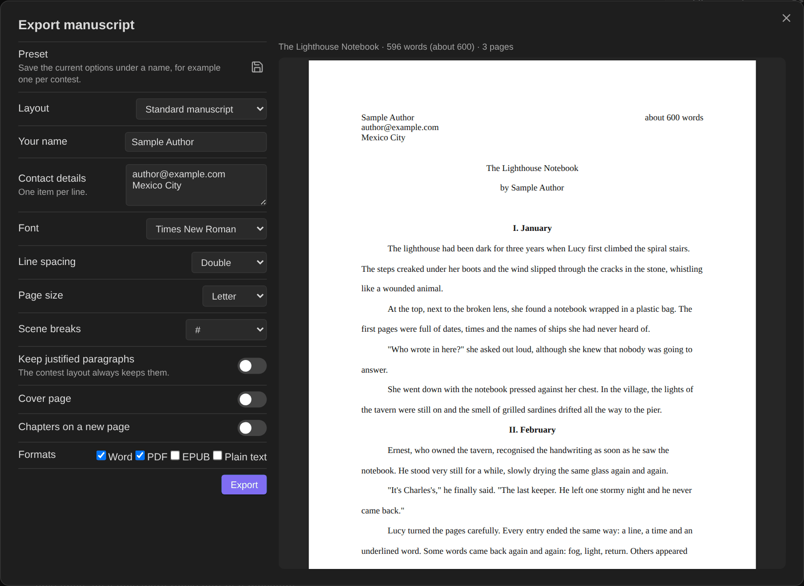
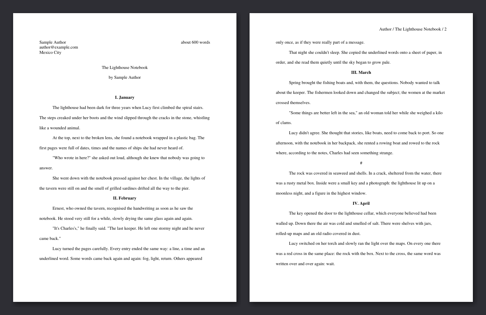
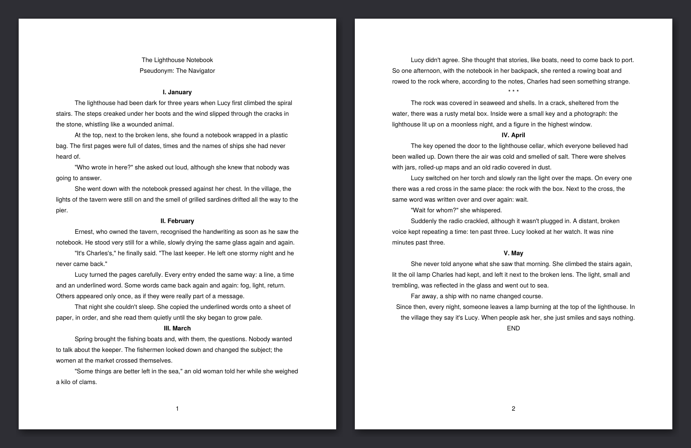
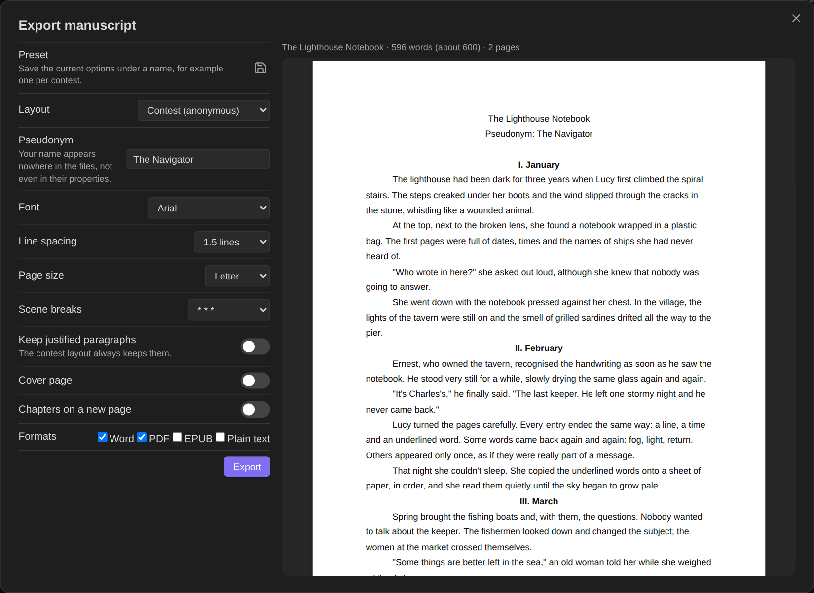
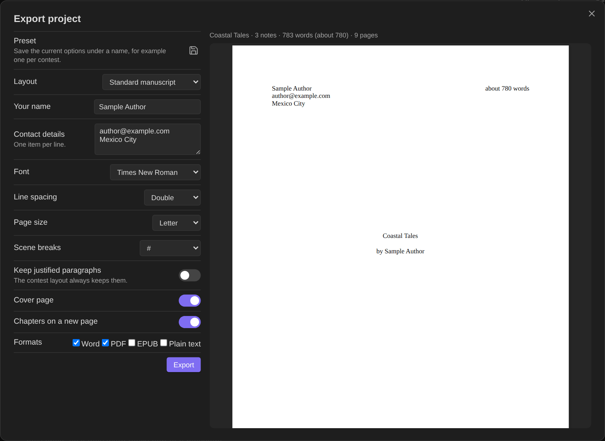

# Manuscript export

Turn a story, a poem or a whole project into files ready to submit: **Word (.docx)**, **PDF**, **EPUB 3** and **plain text**. Everything is generated inside Obsidian, without an internet connection, on desktop and mobile.

Open it with **Export manuscript…** in the note's ⋯ menu or the file explorer, or the command *Export manuscript as a document or PDF…*.

## The export window

On the left, the options; on the right, a **live preview of every page**, redrawn as you change anything. The PDF is printed from exactly this layout, so what you see is what you get. The summary above the preview shows the title, the word count (exact and rounded, as manuscripts state it) and the number of pages.

| Option | Choices |
|---|---|
| **Preset** | Save the current options under a name (for example one per contest or magazine) and apply them in one tap. Presets never store your name or contact details. |
| **Layout** | *Standard manuscript* or *Contest (anonymous)*. |
| **Your name / contact details** | For the standard layout (city, email, phone… one per line). Also set in the settings. |
| **Pseudonym** | For the contest layout. A note's `pseudonym` property overrides the default. |
| **Font** | Times New Roman, Courier or Arial, 12 pt. |
| **Line spacing** | Double or 1.5. |
| **Page size** | Letter or A4. |
| **Scene breaks** | `#`, `* * *`, `—` or a blank line. |
| **Keep justified paragraphs** | Paragraphs marked as justified stay justified in the standard layout (the contest layout always keeps them). |
| **Cover page** | The title on a page of its own; the text starts on page 2. |
| **Chapters on a new page** | Each top-level heading starts a new page. |
| **Formats** | Any combination of Word, PDF, EPUB and plain text. |

The files are saved in an **`Exports`** folder next to the note (or inside the exported folder), named after the note; contest files get *(contest)* / *(concurso)* in the name.

## Two layouts

### Standard manuscript

The format most publishers and agents ask for:

- Your **name and contact details** top left, the **word count rounded** (*about 600 words*) top right.
- The **title** and a **byline** (*by Sample Author*) one line below; if the note has a subtitle that already names you (*Un relato de …*), it replaces the byline.
- From page 2, a running header: **Surname / Title / page number**.
- First-line indents, no blank lines between paragraphs, *END* / *FIN* at the end.

### Contest (anonymous)

For contests with blind judging:

- Only the **title** and **Pseudonym: …**, page numbers at the bottom.
- Your name appears **nowhere**: not in the text, not in a subtitle that names you (it's left out), not in the files' properties or metadata.

## What goes into the manuscript

The note is converted to a manuscript model first, the same for every format:

- The first `#` heading is the **title** (or the `title` property). A heading right under it is the **subtitle**, unless it is your name (a byline, dropped) or the first of several sections at its level (a story that opens with `## Chapter 1`).
- Every line is a **paragraph**, the way it reads in Obsidian. **Italics** and **bold** are kept.
- Headings become section titles; **scene-break lines** (`***`, `---`, `* * *`, `#`, `⁂`…) become the chosen symbol.
- **Alignment** markers are respected: centred and right-aligned paragraphs keep their alignment; justified ones are justified in the contest layout or with *Keep justified paragraphs*.
- **Left out:** front matter, callouts (concept art, notes to self), comments, images, tables, code, footnote markers, block IDs, and link syntax (`[[note|shown]]` prints *shown*).
- **Poems** keep their lines, indentation and stanzas (see [Poetry](Poetry)).

## Whole projects

Export several notes as one manuscript:

- **An anthology note:** run the export on a note with `type: anthology`. It collects the notes linked from it, then every story whose `anthology` property links to it.
- **A folder:** right-click a folder → **Export folder as one manuscript…**. Subfolders are included in name order.

Notes are ordered by their `order` property, then `date_created`, then name. Each note becomes a **chapter** that starts on a new page, titled with the note's title (its byline or subtitle is dropped), and the first page shows the **total word count**. All formats and both layouts work with projects; the EPUB gets one chapter per note with a table of contents.

## The formats

| Format | Details |
|---|---|
| **Word (.docx)** | Uses the real fonts, page size, margins (1 inch), header or footer with the page number, line spacing and indents. Opens in Word, Pages, Google Docs and LibreOffice. |
| **PDF** | Drawn page by page from the preview layout with exact font metrics, using the PDF standard fonts (Times, Helvetica for Arial, Courier). |
| **EPUB 3** | A valid e-book (checked with EPUBCheck): title page, one file per chapter, navigation and a table of contents for older readers, language and author or pseudonym metadata. |
| **Plain text** | For submission forms that ask you to paste the story: no markup, scene breaks kept, emphasis dropped. |

For the Word file with **tracked changes** since a draft, see [Revision mode](Revision-mode#tracked-changes-for-your-editor).

## Limits

The PDF standard fonts cover English, Spanish and other Western European languages; characters outside that set (Greek, Cyrillic, CJK) print as "?" in the PDF. Word files use the real fonts and have no such limit.
