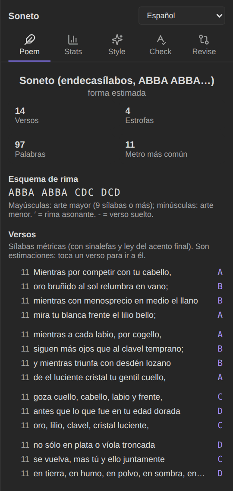
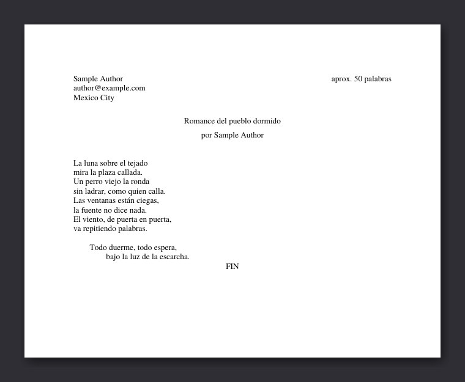

# Poetry

Mark a note with `type: poem` (also `poema` or `poesía`), or add `poem` to its `cssclasses`, and it is treated as verse.

## Layout

Markdown is unkind to poems: indented lines turn into code blocks, and with "strict line breaks" lines run together. In poem notes:

- **Every line stays a line** and keeps its **indentation**, in the editor and in Reading view.
- Long lines wrap with a **hanging indent**, so it's clear where a line of verse begins.
- A blank line separates **stanzas**.
- `%%center%%` or `%%right%%` at the start of a stanza aligns the whole stanza (see [Formatting tools](Formatting-tools)).
- Comments (`%% … %%`), such as instructions in a template, are not shown or counted as verse.

## The Poem tab

- **Form**, when the poem matches one: sonnet (14 hendecasyllables; ABBA ABBA… for the classic Spanish scheme), haiku (5‑7‑5), *décima espinela* (ten octosyllables, abbaaccddc), *romance* (octosyllables with the same assonance on even lines), couplets, tercets, quatrains up to octaves, isometric verse (all lines the same length) or free verse. The form is an estimate.
- **Lines, stanzas, words** and the most common **metre**.
- **Rhyme scheme** by stanza.
- **Every line** with its syllable count and rhyme letter. Tap a line to jump to it; hover it to see how the count was reached.

The labels follow the poem's language (*Versos, Estrofas, Esquema de rima…* in Spanish).

 

## How syllables are counted

### Spanish: *métrica*

Spanish poetry counts **metrical** syllables, not grammatical ones:

1. **Grammatical syllables** of each word: vowels together form a diphthong unless both are strong (a, e, o) or the weak one is accented (*hiato*: *ma-rí-a*). *qu* and *gu* before e/i are one sound; *ü* keeps its vowel.
2. **Sinalefa:** the last vowel of a word and the first vowel of the next one merge into one syllable (*que‿es-tá*), also across a silent *h* (*no‿ha-bla*). The conjunction *y* is a vowel (*labio y frente*) except before another vowel, where it sounds like a consonant (*y el*); a final *y* (*soy*, *hoy*) closes a diphthong and does not merge with the next word.
3. **Ley del acento final:** the count depends on the stress of the last word. A line ending in an *aguda* (stress on the last syllable: *can-tar*) adds one; an *esdrújula* (*pá-ja-ro*) subtracts one; a *llana* stays as it is.

So *"Ca-mi-nan-te, no‿hay ca-mi-no"* has 9 grammatical syllables and 8 metrical ones (the llana *camino* adds nothing).

### English

English has no fixed metrical rules of this kind, so the count is an approximate syllable count per word (vowel groups, a silent final *e*, *-ed* and *-es* endings). Stress patterns (iambic pentameter and so on) are on the [roadmap](https://github.com/danielroa98/Authors-Toolbox#roadmap-possible-changes).

## How rhyme is found

The rhyme of a line is its last word **from the stressed vowel to the end**: *cabello* → *-ello*, *gitana* → *-ana*.

- Lines with the same ending have **consonant rhyme** (rima consonante) and share a letter: A, B, C…
- In Spanish, lines that share only the **vowels** of that ending (*callada* / *escarcha*: á‑a) have **assonant rhyme** (rima asonante), shown with ′ (a′, b′).
- **Uppercase** letters mark *arte mayor* (lines of 9 syllables or more), **lowercase** *arte menor*; `-` is an unrhymed line (verso suelto).
- *ñ* is kept as a distinct sound, so *montaña* and *gitana* don't rhyme, though they share the assonance á‑a.

## Export

Poems keep their layout in every [export](Manuscript-export) format: single-spaced lines with their indentation, a blank line between stanzas, never justified.

## Limits

Syllable counts and rhyme are estimates. Poets bend the rules on purpose (*sinéresis*, *diéresis*, licences), and a word's stress can depend on its meaning. The Poem tab is a second pair of eyes, not a judge.
