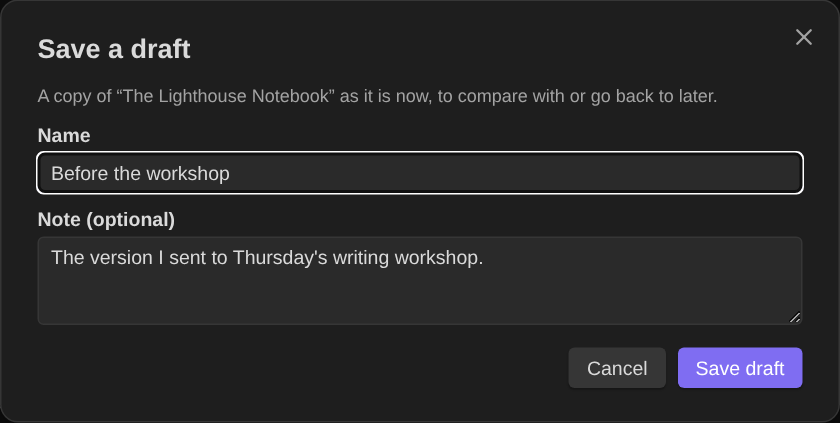
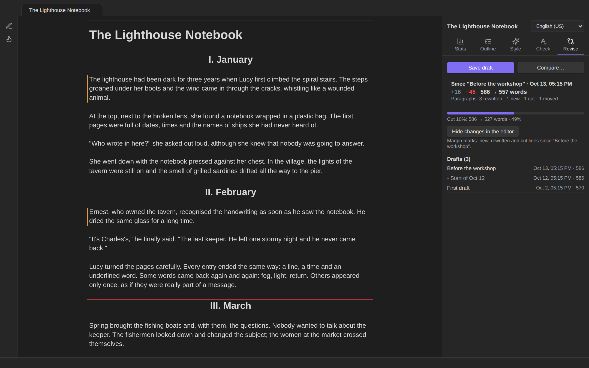
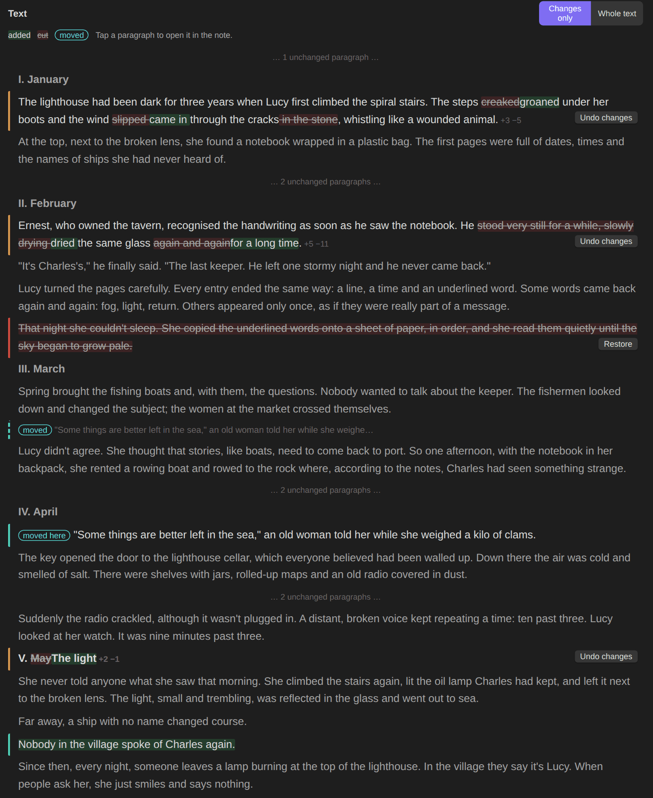
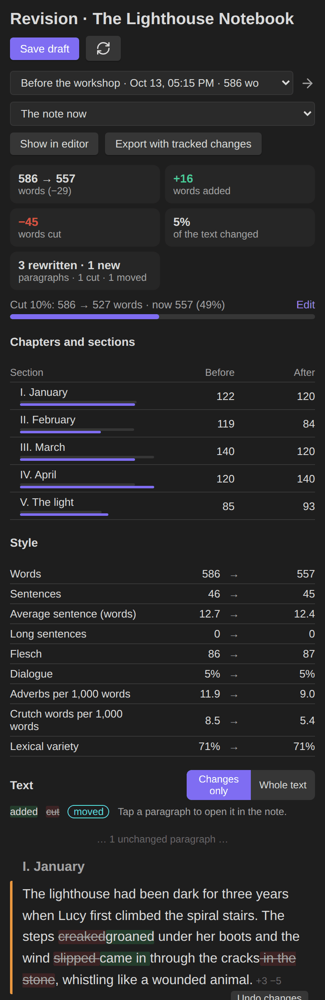
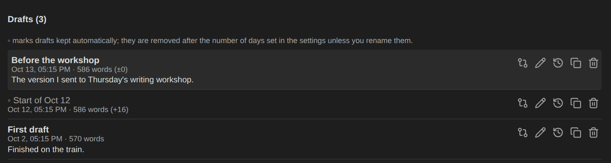
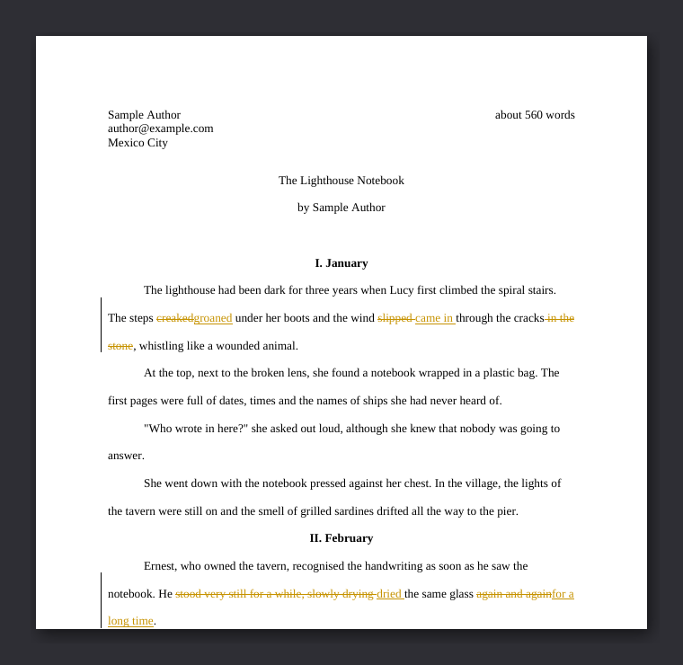

# Revision mode

Drafting and revising are different jobs. While you draft, the word count goes up and the habits dashboard cheers you on. While you revise, the count may go down, and what matters is **what changed**: which paragraphs you rewrote, what you cut, whether a chapter grew, whether your sentences got tighter. Revision mode keeps **drafts** of a note and shows the changes between any two versions.

## Drafts

A draft is a copy of the whole note at a moment in time.

- **Save a draft:** the **Revise** tab of the writing panel, the note's ⋯ menu, or **Save a draft of this note…**. Give it a name (*Before the workshop*) and, if you like, a note (*The version I sent to Thursday's workshop*).

  

- **Daily drafts:** the first time you open a note from your writing folders each day, its text is kept automatically as *Start of 14 Oct*, if it changed since the last draft. You can always see what you changed today, and go back. Automatic drafts are marked ◦ and kept for **30 days** (a setting); renaming one makes it permanent. Named drafts stay until you delete them.
- Drafts are stored in your vault in a hidden folder, **`.authors-toolbox/drafts`** (a setting), one small file per note. See [where drafts live](#where-drafts-live).

## The Revise tab

In the writing panel, for the current note:

- **Save draft** and **Compare…**
- **Since the last draft:** words added and cut, words before → after, and paragraphs rewritten, new, cut and moved. (It compares with the latest draft that differs from the note.)
- The **revision goal**, if there is one, with a progress bar.
- **Show changes in the editor** (see below).
- The six most recent drafts; tap one to compare it with the note.

## Comparing versions

**Compare…** or **Compare drafts of this note** opens the revision page. At the top, choose the **older version** (a draft) and the **newer version** (*The note now* or another draft). Then:

### Summary

Words before → after, **words added**, **words cut**, **how much of the text changed** (added + cut over the words of both versions), and paragraphs **rewritten · new · cut · moved**.

### Revision goal

A goal measured from a draft: **cut a percentage** (*cut 10%: 586 → 527 words*) or **reach a number of words** (*reach 5,000 words*). The bar shows how far along you are; it turns green when you get there. Set it from the revision page, the Revise tab or **Set a revision goal for this note…**.

### Chapters and sections

Every heading is a section. For each: words **before** and **after** (with two small bars to compare at a glance), words **added** and **cut**, and its status:

| Status | Meaning |
|---|---|
| **Revised** | Text was added or cut inside it. |
| **Renamed** | Only its heading changed. |
| **Moved** | It changed place relative to the other sections. |
| **New** / **Cut** | It exists in only one of the versions. |

Paragraphs moved from one chapter to another change both chapters' word counts but don't count as added or cut.

### Style

Before → after for the numbers that change when you revise: words, sentences, average sentence length, long sentences, readability (Flesch or INFLESZ), dialogue share, adverbs and crutch words per 1,000 words, and lexical variety. A ▲ or ▼ marks what moved.

### The text

The newer version with the changes marked:

- **New paragraphs** with a green bar; **cut paragraphs** struck through with a red bar; **rewritten paragraphs** with an orange bar and the words cut and added marked inside (*The steps ~~creaked~~ groaned under her boots*), with a count like *+3 −5*.
- **Moved paragraphs** are tagged *moved here*, with a faint *moved* line where they used to be.
- **Changes only** (the default) shows each change with one paragraph of context and folds the rest (*… 5 unchanged paragraphs …*); **Whole text** shows everything.
- **Tap a paragraph** to open the note at that line.
- **Restore** puts a cut paragraph back where it was; **Undo changes** brings back a rewritten paragraph's earlier wording. Both only work if the note still reads as compared, and both can be undone in the editor.

On a phone the page stacks into one column:

### Draft history

At the bottom, every draft with its date, words and change from the previous draft, and its note. For each:

- **Compare with the note now**;
- **Rename or add a note** (renaming an automatic draft makes it permanent);
- **Restore this draft:** the note's text is replaced by the draft's. The current text is saved as a draft first (*Before restoring "…"*), and the note keeps its current properties (status, genre…);
- **Copy to a new note**, next to the original;
- **Delete**.

## Changes in the editor

**Show changes in the editor** (Revise tab, revision page, or the command *Show or hide changes since the last draft in the editor*) marks the margin of the editor:

- a **green** bar on new lines,
- an **orange** bar on rewritten lines,
- a **red** line where text was cut.

The marks update as you type, so you can revise with the old version in mind without opening it. Run the command again to hide them.

## Tracked changes for your editor

**Export with tracked changes** (revision page) or **Export the changes since the last draft with tracked changes (.docx)** writes a Word manuscript of the note where every change since the draft is a **real tracked change**, with your name as the author. Your editor or workshop can see exactly what you changed and accept or reject each change in Word, Pages, Google Docs or LibreOffice. Track changes is left on in the file, so their edits are tracked too.

The file uses your [manuscript export](Manuscript-export) settings (font, spacing, page size, name and contact) and is saved in the `Exports` folder as *Story (changes since Draft 1).docx*.

## Where drafts live

- One JSON file per note in **`.authors-toolbox/drafts`** at the root of your vault, named after the note plus a short hash of its path.
- The leading dot hides the folder from Obsidian: drafts never appear in search, the graph, the file explorer, Dataview queries or word counts.
- They are ordinary files in your vault folder, so they **sync** with iCloud, Dropbox, Git or Obsidian Sync (for Obsidian Sync, hidden folders follow its settings), and they **stay if you uninstall the plugin**.
- **Renaming** a note keeps its drafts. Deleting a note keeps them too, so the text can still be recovered.
- To keep drafts somewhere visible, change *Drafts folder* in the settings to a normal folder.

## How the comparison works

See [How it works → Comparing versions](How-it-works#comparing-versions) for the algorithm: paragraph alignment with a Myers diff, pairing rewritten paragraphs by similarity, word-level differences, move detection and section matching.
