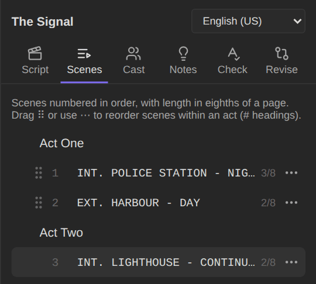
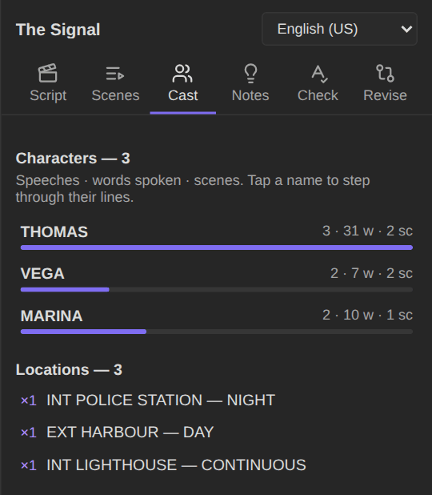
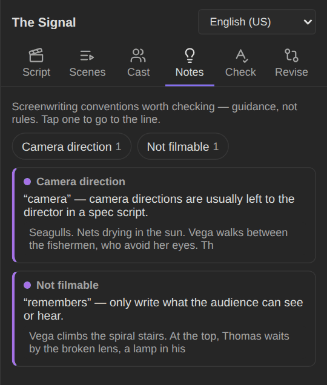

# Screenplays

Notes with `type: script` are written in **[Fountain](https://fountain.io)**, the plain-text screenplay format, and shown as a screenplay: Courier, standard indents for each element, in the editor (Live Preview), in Reading view and in Obsidian's PDF export.

## Writing a script

Fountain needs no special markup for most things. Authors Toolbox recognises:

| Element | How to write it |
|---|---|
| **Scene heading** | A line starting with `INT.`, `EXT.`, `INT./EXT.`, `I/E` or `EST.`, or any line starting with `.` (forced). |
| **Character** | A line in CAPITALS followed by dialogue. `@Name` forces it. Extensions like `(V.O.)`, `(O.S.)`, `(CONT'D)` are kept. |
| **Parenthetical** | A line in `( )` under a character or inside dialogue. |
| **Dialogue** | The lines after a character. |
| **Transition** | A line in capitals ending in `TO:`, or `FADE IN:`, `FADE OUT.`, `CUT TO BLACK.`, and the Spanish `FUNDIDO A NEGRO`, `CORTE A:`… `>` forces one. |
| **Centered text** | `> THE END <` |
| **Acts and sequences** | `#` and `##` headings group scenes. |
| **Page break** | `===` |
| **Lyrics** | A line starting with `~`. |
| **Notes** | A line in `[[ … ]]`, or an Obsidian comment `%% … %%` (exported as a Fountain note). |
| **Action** | Everything else. `!` forces a line to be action. |

### While you type

- **Smart Enter:** after a character name or a parenthetical, Enter starts the dialogue on the next line; after dialogue or action, it leaves the blank line the next element needs. **Shift+Enter** always inserts a plain line break. (Turn it off with *Smart line breaks in scripts*.)
- **Suggestions:** typing a character name in capitals suggests the characters already in the script, plus `(V.O.)`, `(O.S.)` and `(CONT'D)`. In scene headings, it suggests the locations you used and the times of day, in English and Spanish (`DAY`, `NIGHT`, `CONTINUOUS`, `DÍA`, `NOCHE`, `CONTINUO`…).
- **Format line as…** scene heading, action, character, parenthetical, transition or centered, from the right-click menu or the commands. It rewrites the line in the right form (for example `cocina - noche` → `INT. COCINA - NOCHE`).

## The script tabs

### Script

Estimated **pages** and **screen time** (one page ≈ one minute), with the length category (short film up to 40 minutes, medium-length up to 70, feature film beyond) and, if the note has a `format` property (`short`, `feature`, `pilot`), the typical page range for it. Then scenes, speaking characters, locations, average scene length in eighths of a page, the share of dialogue, words, INT/EXT and time-of-day counts, a **scene-length chart** (tap a bar to go to that scene) and a Fountain quick reference.

Pages are estimated the way script software counts them: every element is wrapped at its standard width (61 characters for action, 35 for dialogue, 26 for parentheticals…) and a page holds 55 lines.

### Scenes

A numbered scene board grouped by act, with each scene's length in eighths of a page. **Drag** a scene (⠿) or use its ⋯ menu to move it within its act; the whole scene, up to the next heading, moves in one undo step.

### Cast

Every speaking character with speeches, words spoken and the number of scenes they appear in (tap a name to step through their lines), and every location.

### Notes

Coaching on screenwriting conventions. These are suggestions, not rules:

- action paragraphs longer than 4 lines, and speeches longer than 6;
- scene headings without INT./EXT., without a time of day, or not in capitals;
- long parentheticals (they're for brief delivery notes);
- camera directions (*the camera pans*, *close on*…) in a spec script;
- things the camera can't show (*thinks*, *remembers*, *recuerda*…);
- characters who speak before they're introduced in the action in CAPITALS.

Tap a note to go to the line.

## New scripts and adaptations

- **Screenplay: new script…** creates a script in the scripts folder from a built-in template: the title-page properties (`title`, `credit`, `author`, `draft_date`, `format`), a logline callout, and a first scene that shows how each element is written.
- **Screenplay: adapt this story into a script** creates a script linked to the story (`adapted_from: "[[Story]]"`), in the story's language, and opens it next to the story so you can adapt it scene by scene.
- **Screenplay: turn script formatting on/off for this note** adds or removes `type: script`.

## Export

**Screenplay: export as .fountain** writes a `.fountain` file into an `Exports` folder next to the script, with a title page from the note's properties (`title`, `credit`, `author`, `adapted_from`, `draft_date`, `contact`). Callouts and images are left out and comments become Fountain notes (`[[ … ]]`). Open it in Final Draft, Fade In, Highland, WriterSolo or Beat.

The spelling and grammar check works in scripts too, and skips character names, scene headings and transitions.
