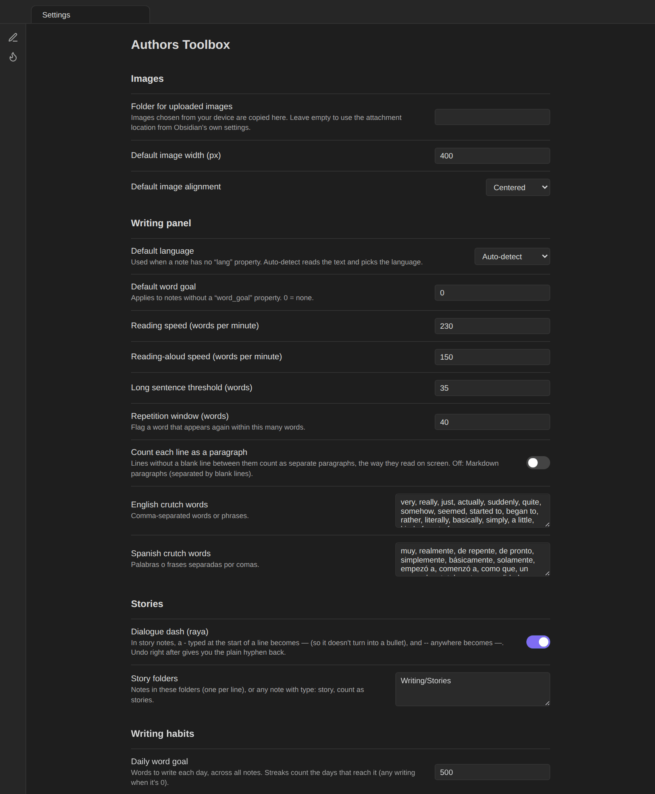

# Settings

All options are in **Settings → Authors Toolbox**. On Obsidian 1.13 and later they are also searchable from the settings search box.

## Images

| Setting | Default | What it does |
|---|---|---|
| **Folder for uploaded images** | — | Images chosen from your device are copied here. Leave empty to use the attachment location from Obsidian's own settings. |
| **Default image width (px)** | 400 |  |
| **Default image alignment** | Centered | Options: Inline, Centered, Left, Right. |

## Writing panel

| Setting | Default | What it does |
|---|---|---|
| **Default language** | Auto-detect | Used when a note has no “lang” property. Auto-detect reads the text and picks the language. |
| **Default word goal** | 0 (none) | Applies to notes without a “word_goal” property. 0 = none. |
| **Reading speed (words per minute)** | 230 |  |
| **Reading-aloud speed (words per minute)** | 150 |  |
| **Long sentence threshold (words)** | 35 |  |
| **Repetition window (words)** | 40 | Flag a word that appears again within this many words. |
| **Count each line as a paragraph** | Off | Lines without a blank line between them count as separate paragraphs, the way they read on screen. Off: Markdown paragraphs (separated by blank lines). |
| **English crutch words** | *very, really, just, actually, suddenly…* | Comma-separated words or phrases. |
| **Spanish crutch words** | *muy, realmente, de repente, de pronto…* | Comma-separated words or phrases (Spanish notes). |

## Stories

| Setting | Default | What it does |
|---|---|---|
| **Dialogue dash (raya)** | On | In story notes, a - typed at the start of a line becomes — (so it doesn't turn into a bullet), and -- anywhere becomes —. Undo right after gives you the plain hyphen back. |
| **Story folders** | — | Notes in these folders (one per line), or any note with type: story, count as stories. |

## Writing habits

| Setting | Default | What it does |
|---|---|---|
| **Daily word goal** | 0 (none) | Words to write each day, across all notes. Streaks count the days that reach it (any writing when it's 0). |
| **Writing folders** | — | Folders with your works, one per line, for the genre, form and project breakdowns. Empty: the story folders and the scripts folder. |
| **Default sprint length (minutes)** | 25 |  |
| **Default sprint word target** | 500 | Leave at zero for no target. |

## Revision

| Setting | Default | What it does |
|---|---|---|
| **Keep a daily draft automatically** | On | The first time you open a note in your writing folders each day, its text is kept as a draft if it changed since the last one, so you can always see what you changed today or go back. |
| **Keep automatic drafts for (days)** | 30 | Named drafts are kept until you delete them. |
| **Drafts folder** | `.authors-toolbox/drafts` | Where drafts are stored in your vault, one file per note. Folders starting with a dot are hidden from Obsidian (search, graph, Dataview) but sync with the vault. |

## Manuscript export

| Setting | Default | What it does |
|---|---|---|
| **Default layout** | Standard manuscript | Standard manuscript shows your name, contact details and word count. The contest layout is anonymous: only the title and your pseudonym. Options: Standard manuscript, Contest (anonymous). |
| **Font** | Times New Roman | Options: Times New Roman, Courier, Arial. |
| **Line spacing** | Double | Options: Double, 1.5 lines. |
| **Page size** | Letter | Options: Letter, A4. |
| **Contact details** | — | Printed under your name on the first page of a standard manuscript, one item per line (city, email, phone…). |
| **Pseudonym** | — | Used by the contest layout. A note's “pseudonym” property overrides it. |
| **Start chapters on a new page** | Off | Each top-level heading begins a new page. In a project export every story or chapter note always starts a new page. |
| **Keep justified paragraphs** | Off | Paragraphs marked as justified stay justified in the standard layout too. The contest layout always keeps them. |
| **Scene-break symbol** | `#` | Options: #, * * *, —, Blank line. |
| **Cover page** | Off | Title on a page of its own; the text starts on page 2. |

## Screenplays

| Setting | Default | What it does |
|---|---|---|
| **Scripts folder** | `Scripts` | Folder where new scripts and story adaptations are created. |
| **Author name** | — | Written on the title page of new scripts and on exported manuscripts. |
| **Smart line breaks in scripts** | On | After a character name or parenthetical, the return key starts the next dialogue line; after dialogue or action it starts a new element (blank line). Shift+Enter always inserts a plain line break. Reload the plugin after changing. |

## Spelling & grammar

| Setting | Default | What it does |
|---|---|---|
| **Allow sending text to the grammar service** | Off | Checks run only when you ask: from the panel, a command, or the editor's context menu. The text in the chosen scope is sent to the server below (LanguageTool). Obsidian's built-in spellcheck keeps working alongside it; on macOS and iOS it follows your keyboard languages. |
| **Server** | `https://api.languagetool.org` | Default: https://api.languagetool.org (free). You can point this to your own LanguageTool server. |
| **Premium username (email)** | — | Optional. A premium account gives higher limits and more checks. |
| **Premium API key** | — |  |
| **Picky mode** | Off | Extra style and punctuation suggestions. |
| **Personal dictionary** | — | One word per line (character names, places, invented words). These are never flagged as misspelled. |
| **Turned-off rules** | `WHITESPACE_RULE` | Rule IDs from the grammar service, comma-separated. |
## Settings kept elsewhere

Some choices are saved from where you make them rather than in this tab:

- the panel's current tab, the dashboard's range (30 / 90 / 365 days) and the revision page's *Changes only / Whole text*;
- export **presets** (from the export window);
- the daily word history and the sprint log;
- your note's language, word goal and genre (as note properties, see [Note properties](Note-properties)).

All of it is stored in the plugin's `data.json`, except drafts (see [Revision mode](Revision-mode#where-drafts-live)).
