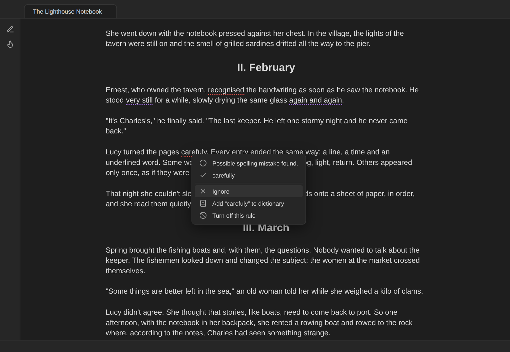

# Spelling and grammar

Obsidian has no grammar checker, and its spellcheck follows the operating system (on macOS it often offers nothing when you write in two languages). Authors Toolbox adds an **on-demand** spelling, grammar, punctuation and style check powered by [LanguageTool](https://languagetool.org), in English (US or UK) and Spanish.

## Running a check

1. Open the **Check** tab of the [writing panel](Writing-panel).
2. Choose the scope: **Selection**, **This section** (the chapter or scene around the cursor) or **Whole note**.
3. Press **Check**. The first time, the panel explains what will be sent and asks for permission (*Allow and continue*).

You can also run *Check spelling & grammar: selection / current section / whole note* from the command palette, or *Check spelling & grammar* from the editor's right-click menu when text is selected.

## Results

- Problems are **underlined** in the editor by kind: red for spelling, blue for grammar, amber for punctuation and purple for style.
- The tab lists a **card** per problem with the message, the sentence around it and the suggestions. Filter by kind with the chips at the top (*Spelling 2 · Style 3*). A badge on the tab shows how many are left.
- **Tap a suggestion** to apply it. The underline disappears; editing the underlined text yourself also removes it.
- **Ignore** hides that one problem.
- **Add to dictionary** (spelling only) adds the word to your personal dictionary and removes it everywhere in the results. Use it for character names, places and invented words.
- **Tap an underline** in the editor for the same options in a menu, including **Turn off this rule**.

## Language

The check uses the note's language: the `lang` property, set from the language menu at the top of the panel (*Auto-detect, English (US), English (UK), Español*), or the default language in the settings. Auto-detect compares how many common English and Spanish words the note uses.

## What is skipped

Front matter, code, comments (`%% … %%`), alignment markers, embeds and the Markdown around links and emphasis are never sent as text: the plugin sends the note as **annotated text**, marking those parts as markup so LanguageTool ignores them while the positions of every problem still map back exactly to your note. In scripts, character names, scene headings and transitions are skipped too.

## Long notes and limits

The free LanguageTool service accepts about 20 KB of text per request and 75 KB per minute. Authors Toolbox splits long notes into parts at paragraph boundaries (about 18 KB each; 60 KB with a premium account) and, when needed, waits before sending the next part; the panel shows *Waiting … s for LanguageTool's free-tier limit*.

## Options

In **Settings → Spelling & grammar**:

- **Allow sending text to the grammar service** (the permission from the first check).
- **Server:** `https://api.languagetool.org` by default; point it to your [own LanguageTool server](https://dev.languagetool.org/http-server) to keep text on your network.
- **Premium username and API key** for higher limits and more checks.
- **Picky mode** for extra style and punctuation suggestions.
- **Personal dictionary** (one word per line) and **turned-off rules** (rule IDs, comma-separated).

See [Privacy and your data](Privacy-and-data) for exactly what is sent.
