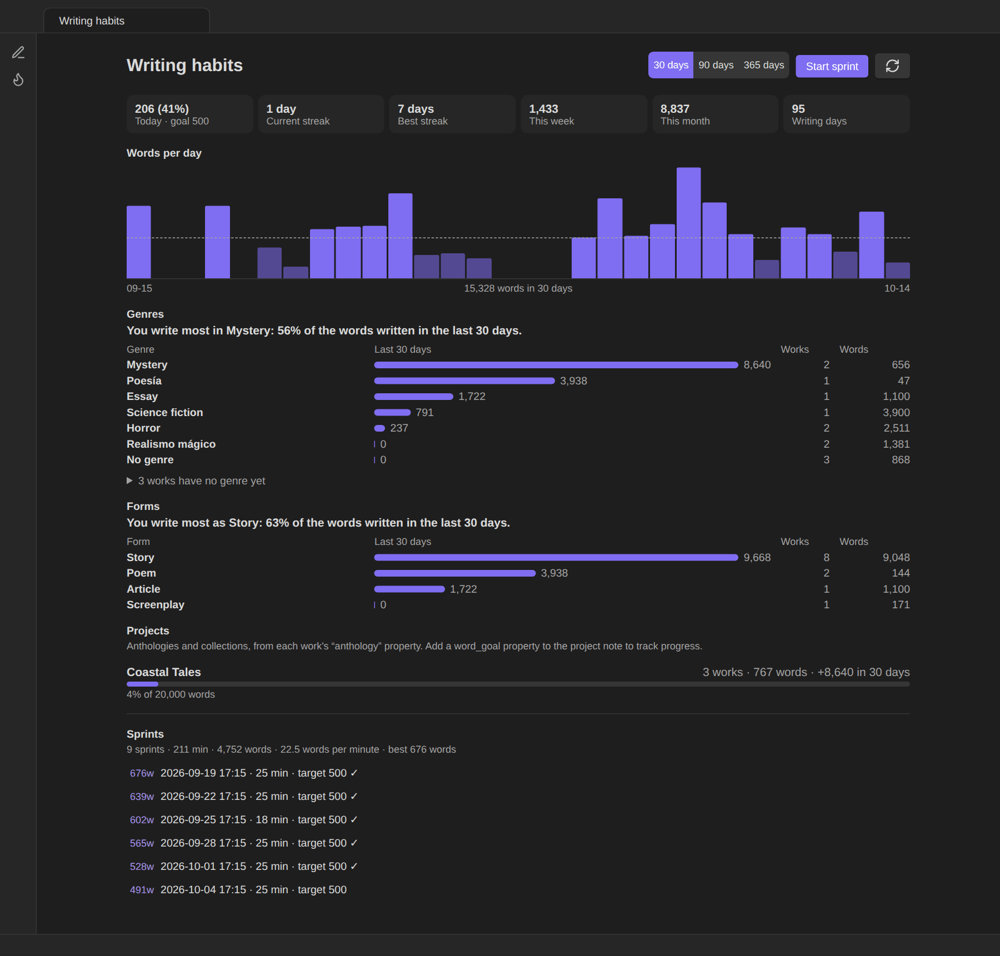
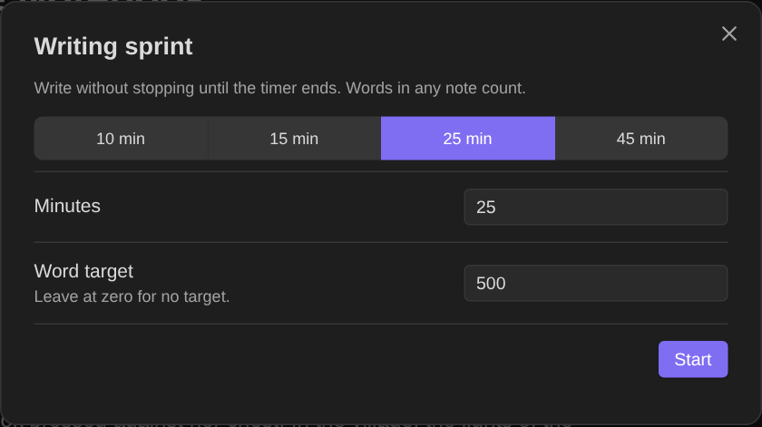
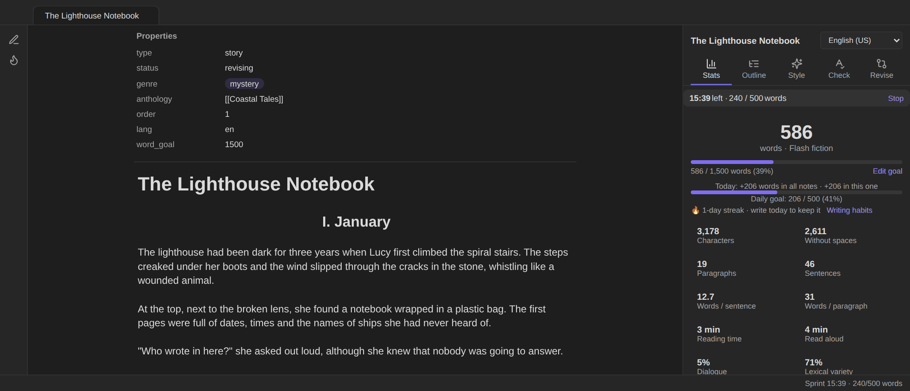
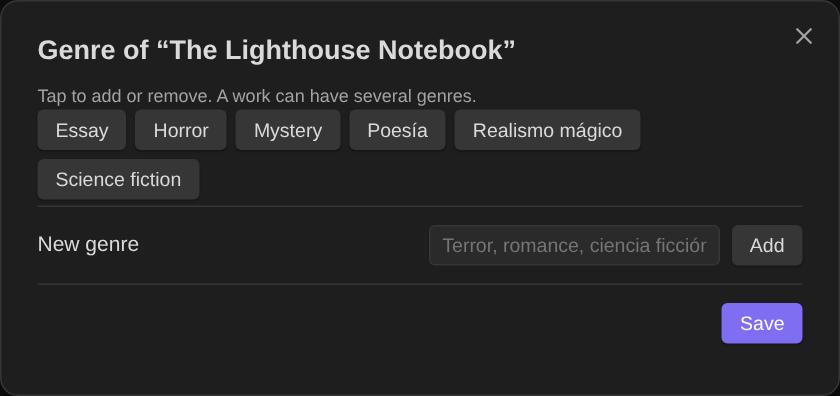

# Writing habits

The writing-habits dashboard shows how much you write, how regularly, and **what** you write. Open it with the **flame icon** in the ribbon or **Open writing habits**.



## Words per day

- A bar for each of the last **30 or 90 days**, or each week of the last **year**, with your **daily goal** as a dashed line. Days that reach the goal are drawn brighter.
- Tiles: **today** (and the share of the goal), **current streak**, **best streak**, **this week**, **this month** and **writing days**.

### How "words written" is counted

For each note and each day, the plugin remembers the word count the first time it saw the note that day and the latest count. **Words written = latest − first**, never below zero, summed over all notes. So:

- cutting a paragraph never "un-writes" a day;
- moving text between notes counts once for the note that grew;
- the count only updates for notes you open in Obsidian (it reads the editor, not the disk).

About **13 months** of history are kept (400 days) in the plugin's settings, and renaming a note keeps its history.

### Goals and streaks

- **Daily goal** (Settings → Writing habits) is a number of words across all notes. A **streak** counts consecutive days that reach it; with no goal, any writing counts. Today doesn't break the streak until it's over.
- A note's own **word goal** (`word_goal` property) is shown in the [Stats tab](Writing-panel#stats).

## Writing sprints

A sprint is a timed burst of writing with a word target.



- Start one from the dashboard, the Stats tab or **Start a writing sprint…**: choose the minutes (10, 15, 25, 45 or your own) and a word target (0 for none).
- A countdown and the words written so far appear in the **status bar** and at the top of the **writing panel**. Words in any note count.
- At the end (or with **Stop the writing sprint**) a summary shows words, words per minute and whether you hit the target. Sprints are kept in a log; the dashboard shows how many, total minutes and words, average speed and your best sprint.



## Genres: what you write most

Give each work a **`genre`** property, one or several:

```yaml
genre: [horror, cuento urbano]
```

(`genres` and `género` work too.) Or use **Set genre of this note…**, which suggests the genres you already use:



The dashboard then shows:

- **"You write most in …"**: the genre with the most words written in the selected period, and its share.
- A row per genre: words written in the period (bar), number of **works** and their total **words**.
- **Works with no genre yet**, so you can tag them in place.

Genres are matched regardless of capitals (*terror* and *Terror* are the same genre), and values written as `#terror` or `[[terror]]` work too. A work with two genres counts fully in both.

## Forms and projects

- **Forms:** the same breakdown by kind of work, from the `type` property: story, poem, screenplay, article, essay…
- **Projects:** works grouped by their `anthology` property, with total words, words written in the period and progress towards the project note's `word_goal`.

Both read the notes in your **writing folders** (Settings → Writing habits; by default the story folders and the scripts folder). Hub and anthology notes themselves are not counted as works.
