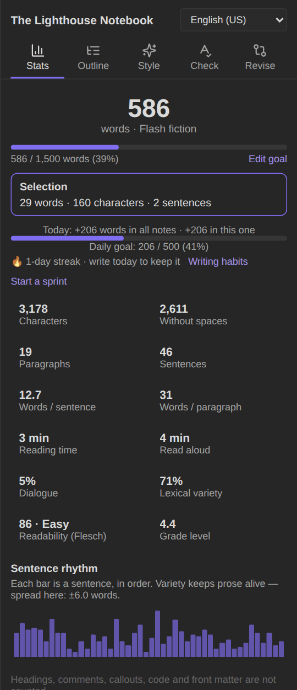
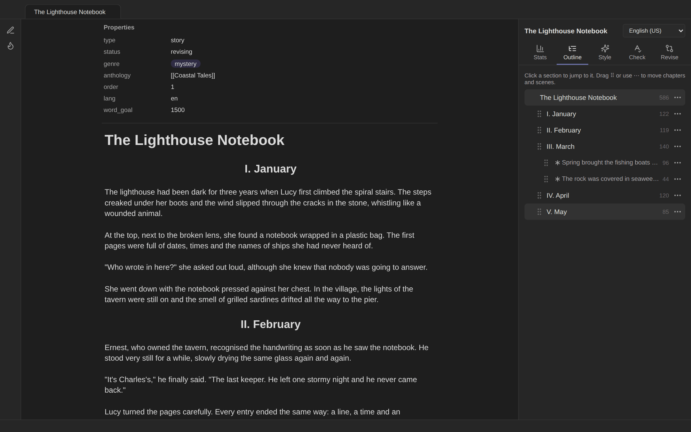
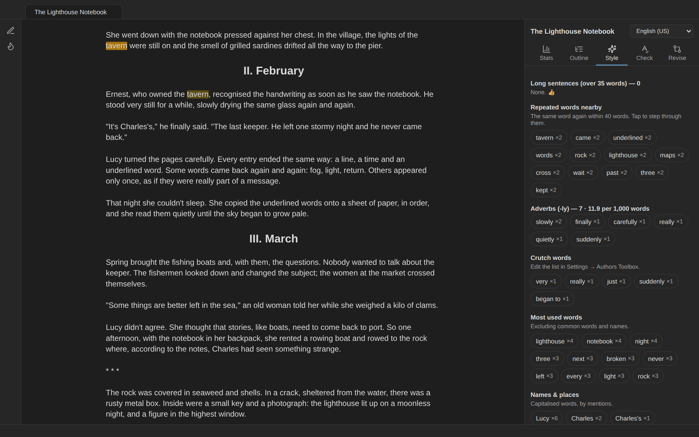

# Writing panel

The writing panel is a sidebar about the note you're working on. Open it from the **pen icon** in the ribbon or with **Open writing panel**. It follows the active note and updates a moment after you stop typing.

At the top: the note's name and a **language menu** (Auto-detect, English US, English UK, Español). Choosing a language saves it as the note's `lang` property; it decides which rules the statistics, style insights and grammar check use, and sets the hyphenation language for justified text.

The tabs depend on the kind of note:

| Note | Tabs |
|---|---|
| Story or any prose note | **Stats · Outline · Style · Check · Revise** |
| Poem (`type: poem`) | **Poem · Stats · Style · Check · Revise** (see [Poetry](Poetry)) |
| Script (`type: script`) | **Script · Scenes · Cast · Notes · Check · Revise** (see [Screenplays](Screenplays)) |

The **Check** tab is described in [Spelling and grammar](Spelling-and-grammar) and **Revise** in [Revision mode](Revision-mode).

## Stats

- **Word count** and a **length category**: flash fiction (under 1,000), short story (1,000–7,499), novelette (7,500–17,499), novella (17,500–39,999), novel (40,000 and over).
- **Word goal:** a progress bar towards the note's `word_goal` property (or the default goal in the settings). *Edit goal* changes it.
- **Today:** words written today in all notes and in this one, the **daily goal**, your **streak**, and links to [writing habits](Writing-habits) and a sprint.
- **Selection:** select text to see its words, characters and sentences.
- Characters (with and without spaces), paragraphs, sentences, words per sentence and per paragraph.
- **Reading time** and **read-aloud time** (230 and 150 words per minute by default; both are settings).
- **Dialogue:** the share of words inside dialogue.
- **Lexical variety:** the moving-average type/token ratio over 100-word windows; higher means a richer vocabulary.
- **Readability:** Flesch Reading Ease and the Flesch–Kincaid grade level for English, INFLESZ (Szigriszt-Pazos) for Spanish.
- **Sentence rhythm:** one bar per sentence, in order. A flat row of bars means sentences of the same length; varied bars read more naturally.

Headings, comments, callouts, code blocks, tables and front matter are left out, so the numbers describe your prose.

 

**Paragraphs:** by default a paragraph is a Markdown paragraph (text between blank lines). Turn on *Count each line as a paragraph* in the settings if you write one paragraph per line without blank lines.

## Outline

The outline lists the note's **chapters** (headings) and **scenes** (text between scene-break lines) with their word counts.

- **Scene breaks:** a line with only `---`, `***`, `___`, `* * *`, `#`, `⁂`, `§` or `~~~`.
- **Tap** a row to jump to it in the editor.
- **Reorder** chapters and scenes by dragging the ⠿ handle, or with the ⋯ menu (*Move up*, *Move down*, *Move to top*, *Move to bottom*, and *Select text* to select the whole chapter or scene). The text moves with its heading and all its scenes, blank lines are kept tidy, and the whole move is one undo step.

## Style

Each section lists what to look at; **tap an item to highlight every occurrence in the text**, and tap again to step to the next one.

| Section | What it finds |
|---|---|
| **Long sentences** | Sentences longer than the threshold (35 words by default). |
| **Repeated words nearby** | The same word (four letters or more, not a common word or a name) again within 40 words. |
| **Repeated sentence openers** | Three or more sentences in a row that start with the same word. |
| **Adverbs** | Words ending in *-ly* (English, with a list of exceptions such as *family* or *early*) or *-mente* (Spanish), with a rate per 1,000 words. |
| **Crutch words** | Words and phrases from your lists (*very, really, just, suddenly, began to…* / *muy, de repente, empezó a…*). Edit the lists in the settings. |
| **Most used words** | Content words used three times or more. |
| **Names and places** | Words capitalised (almost) every time they appear in mid-sentence, by number of mentions. Useful for spotting a character who vanishes, or two spellings of a name. |
| **Longest paragraphs** | The three longest paragraphs. |

The rules follow the note's language: Spanish uses Spanish common words, adverbs and crutch words, and recognises dialogue that starts with a raya (—).

## How dialogue is detected

A line that starts with a dash (—, –, or a hyphen right before the text) is a dialogue turn; later dashes on the same line switch between speech and narration (*—Ven. —dijo ella—. Ahora.*). Elsewhere, text inside “…”, «…» or "…" counts as dialogue. Each line is checked on its own, so dialogue in the middle of a paragraph is found too.
